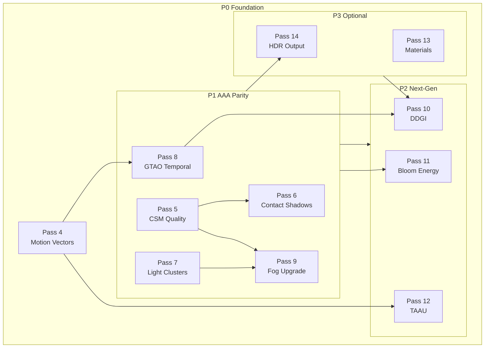

# PyMordial Engine — Graphics Upgrade Plan

> **Status: `PROPOSAL`** — Nothing in this document describes working code.
> It is a prioritised, pass-by-pass plan for closing the gap between the current
> OpenGL 4.5 (ModernGL) deferred renderer and current-gen AAA techniques as used
> in RAGE (Rockstar), Decima (Guerrilla/Kojima) and Crimson Desert (Pearl Abyss).
>
> **Scope of the audit:** `engine/gfx/**` and `shaders/**` only.
> **No code has been modified.** Every pass below is independently implementable,
> independently testable, and independently revertible.

---

## 1. Executive Summary

The renderer is already **structurally** modern: deferred MRT G-buffer, Reversed-Z
with `GL_ZERO_TO_ONE`, hardware MDI over a single MegaBuffer, cascaded shadow atlas
with texel snapping, Hillaire atmosphere LUTs, GTAO, SSGI/Radiance Cascades, Hi-Z
SSR, froxel volumetrics, TAA and a validated render graph. What is missing is
**energy correctness, temporal correctness, and scale**.

Four defects dominate the visual gap and are cheap to fix:

| # | Defect | Where | Why it matters |
|---|---|---|---|
| 1 | Velocity is **camera-only** — `v_PrevClip = u_PrevViewProjection * world_pos` uses the *current* model matrix | [gbuffer.vert](D:/Projects/PyMordial-Engine/shaders/gbuffer.vert) | Every moving object ghosts under TAA. This is the single largest image-quality bug in the engine. |
| 2 | "AgX" is `x/(x+0.1875)` then `pow(1.2)`; ACES is the Narkowicz 2015 fit; output is `pow(1/2.2)` into an 8-bit buffer | [post_process.frag](D:/Projects/PyMordial-Engine/shaders/post_process.frag) | No highlight roll-off, no hue preservation, no wide-gamut working space. |
| 3 | No auto-exposure — `u_Exposure` is a constant | [post_process.py](D:/Projects/PyMordial-Engine/engine/gfx/post_process.py) | Interior/exterior transitions blow out or crush. RAGE/Decima both histogram-adapt. |
| 4 | Single-scatter GGX with no energy compensation | [pbr_brdf.glsl](D:/Projects/PyMordial-Engine/shaders/common/pbr_brdf.glsl) | Rough metals lose 20–40 % of their energy; the "energy conservation" requirement is not met. |

Secondary but high-impact: the "clustered" lighting pass is **not clustered** — the
resolve loops over up to 128 point + 64 spot lights per pixel
([deferred_resolve.frag:848](D:/Projects/PyMordial-Engine/shaders/deferred_resolve.frag)),
and the froxel fog loops 32 point lights per voxel with no spot lights and no
temporal reprojection.

### Priority tiers

| Tier | Passes | Rationale |
|---|---|---|
| **P0 — Foundation** | 1, 2, 3, 4 | Correctness. Everything downstream (bloom, TAA, grading, GI) is wrong without these. |
| **P1 — AAA parity** | 5, 6, 7, 8, 9 | The visible "current-gen" look: contact shadows, soft shadows, many lights, stable AO, clean volumetrics. |
| **P2 — Next-gen** | 10, 11, 12 | World-space GI, physically-plausible bloom, dynamic resolution. |
| **P3 — Optional** | 13, 14 | Material model breadth (clearcoat/SSS/sheen), HDR display output. |

---

## 2. Current Pipeline Audit (verified)

### 2.1 Frame order as implemented

`RenderPipeline.render_frame` ([pipeline.py:1010](D:/Projects/PyMordial-Engine/engine/gfx/pipeline.py)):

```text
0    Clustered lights pre-pass      → SSBO 3 (point/spot arrays)
1    Cascaded Shadow Maps           → 8192² depth atlas, 2×2 equal rects
1.5  Spot shadows                  → 2048² depth atlas, 4 slots
2    G-Buffer (MDI + tess)          → RT0..RT4 + Depth32F
2.5  SSDM                          → RT3 rewrite
2.6  Decals                        → RT0 rewrite
2.7  Hi-Z pyramid                  → R32F mip chain
3    GTAO / SSAO                   → R8 + bilateral blur
4    (lights already uploaded)
5    GI: SSGI XOR Radiance Cascades → RGBA16F
6    IBL + SSR                     → BRDF LUT, env mips, irradiance, SSR
6.5  Sky & atmosphere (Hillaire)   → LUTs
7    Deferred resolve              → RGBA16F HDR
7.5  Debug wireframes
7.6  Froxel volumetric fog         → 3D RGBA16F inject → integrate → composite
7.65 Water                         → HDR
7.7  Particles                     → HDR
7.8  Camera optics (DoF + flare)   → HDR
7.9  TAA                           → RGBA16F history ping-pong
7.95 Motion blur                   → HDR
8    Bloom → Post-process (tonemap) → RGBA8 LDR
8    FXAA XOR SMAA                 → RGBA8
```

### 2.2 Resource inventory

| Resource | Format | Size | Owner |
|---|---|---|---|
| RT0 albedo+roughness | RGBA16F | full | [g_buffer.py](D:/Projects/PyMordial-Engine/engine/gfx/g_buffer.py) |
| RT1 oct-normal+metal+AO | RGBA16F | full | same |
| RT2 velocity | **RG16F** | full | same |
| RT3 displacement info | RGBA16F | full | same |
| RT4 surface ID | R32F | full | same |
| Depth | Depth32F, Reversed-Z | full | same |
| CSM atlas | Depth32F | 8192² | [shadow_csm.py](D:/Projects/PyMordial-Engine/engine/gfx/shadow_csm.py) |
| Spot atlas | Depth32F | 2048² | [spot_shadows.py](D:/Projects/PyMordial-Engine/engine/gfx/spot_shadows.py) |
| AO | R8 | full or scaled | [ao_pass.py](D:/Projects/PyMordial-Engine/engine/gfx/passes/ao_pass.py) |
| SSGI / RC / SSR | RGBA16F | full or scaled | passes |
| HDR scene | RGBA16F | full | [post_process.py](D:/Projects/PyMordial-Engine/engine/gfx/post_process.py) |
| LDR final | **RGBA8** | full | same |
| Fog volumes | 3D RGBA16F ×2 | 160×90×64 | [volumetric_fog_pass.py](D:/Projects/PyMordial-Engine/engine/gfx/passes/volumetric_fog_pass.py) |
| Frame UBO 0 | std140 | 688 B (172 floats) | [frame_context.py](D:/Projects/PyMordial-Engine/engine/gfx/frame_context.py) |

### 2.3 Binding map (must not be disturbed)

| Unit | Consumer | Notes |
|---|---|---|
| 0–2 | albedo, normal, depth | resolve |
| 3 | CSM raw depth | resolve |
| 4 | AO | resolve |
| 5 | SSGI | resolve |
| 6 | BRDF LUT | resolve |
| 7 | env map | resolve |
| 8 | SSR | resolve |
| 9 | CSM compare sampler | resolve |
| 10–11 | sky-view / transmittance LUT | resolve |
| 12 | spot atlas | resolve |
| 13 | irradiance | resolve |
| 14 | Hi-Z | resolve |
| **15** | **radiance cascades** | **reserved — do not reassign** |
| 16 | spot compare sampler | resolve |
| 17–23 | free for render features | [render_services.py](D:/Projects/PyMordial-Engine/engine/gfx/render_services.py) |

SSBO bindings: 1 = transforms, 2 = materials, 3 = lights, 4 = decals, 5 = AABB,
6 = visibility. **UBO binding 1 is free** (uniform and storage binding points are
independent namespaces in GL).

---

## 3. Gap Analysis vs. RAGE / Decima / Crimson Desert

| Technique | RAGE | Decima | Crimson Desert | PyMordial today | Verdict |
|---|---|---|---|---|---|
| Deferred MRT + Reversed-Z | ✅ | ✅ | ✅ | ✅ | parity |
| Hardware MDI / GPU-driven draws | ✅ | ✅ | ✅ | ⚠️ MDI yes, but culling readback stalls CPU | partial |
| CSM + texel snapping | ✅ | ✅ | ✅ | ✅ | parity |
| PCSS / contact hardening | ✅ | ✅ | ✅ | ⚠️ cascade 0 only, scalar light size | partial |
| Screen-space contact shadows | ✅ | ✅ | ✅ | ❌ | **missing** |
| Alpha-tested shadow casters | ✅ | ✅ | ✅ | ❌ (`csm_depth.frag` is empty) | **missing** |
| Static shadow caster caching | ✅ | ✅ | ✅ | ❌ | missing |
| GTAO + bent normals | ✅ | ✅ | ✅ | ⚠️ visibility only | partial |
| SSGI / radiance cascades | ✅ | ✅ | ✅ | ✅ | parity |
| World-space GI probes (DDGI/APV) | ✅ | ✅ | ✅ | ❌ | **missing** |
| Clustered / froxel light lists | ✅ | ✅ | ✅ | ❌ brute-force loop | **missing** |
| Area lights / IES | ✅ | ✅ | ✅ | ❌ | missing |
| Multi-scatter GGX energy comp. | ✅ | ✅ | ✅ | ❌ | **missing** |
| Clearcoat / sheen / SSS / aniso | ✅ | ✅ | ✅ | ❌ | missing |
| Local reflection probes | ✅ | ✅ | ✅ | ❌ single global env | missing |
| Volumetric fog (froxel) | ✅ | ✅ | ✅ | ✅ | parity |
| Fog temporal reprojection | ✅ | ✅ | ✅ | ❌ | **missing** |
| Fog multiple scattering | ✅ | ✅ | ✅ | ❌ | missing |
| Volumetric clouds | ✅ | ✅ | ✅ | ⚠️ 2D deck only | partial |
| TAA with object motion vectors | ✅ | ✅ | ✅ | ❌ camera-only | **broken** |
| Reactive mask / specular AA | ✅ | ✅ | ✅ | ❌ | missing |
| TAAU / dynamic resolution | ✅ | ✅ | ✅ | ❌ | missing |
| Auto-exposure (histogram) | ✅ | ✅ | ✅ | ❌ | **missing** |
| ACES / AgX (real) | ✅ | ✅ | ✅ | ⚠️ approximations | partial |
| Color grading LUT | ✅ | ✅ | ✅ | ❌ | missing |
| HDR display output | ✅ | ✅ | ✅ | ❌ | missing |

---

## 4. Global Constraints (non-negotiable)

These come from [AGENTS.md](D:/Projects/PyMordial-Engine/AGENTS.md) and
[ARCHITECTURE.md](D:/Projects/PyMordial-Engine/docs/reference/ARCHITECTURE.md).
Every pass below is written to respect them.

1. **Zero allocation in the inner loop.** No `list`/`dict`/`np.array` construction
   inside `render_frame`, `on_update`, `on_render`. All new passes pre-allocate in
   `__init__` and reuse scratch buffers.
2. **Engine vs. project separation.** New passes live in `engine/gfx/passes/`.
   Nothing game-specific. Optional capabilities that a project may disable are
   gated by `RenderConfig` flags, never by editing `pipeline.py` per project.
3. **Module boundary.** Anything that could be a module (e.g. DDGI) must be
   expressible as a `RenderFeature` with `after`/`before` anchors against the
   built-in stage names in `_build_render_graph()`.
4. **Reserved debug hotkeys.** `F1`/`F2`/`F3` remain owned by the engine debug
   subsystem. New debug views are added to `u_GBufferDebug` / `EngineTweaks`, not
   to new hotkeys.
5. **Texture unit 15 is reserved** for `u_RCTexture`. New samplers use 17–23.
6. **MDI contract.** `baseVertex` is always 0; indices are pre-offset by
   `MegaBuffer`. Do not "fix" this.
7. **UI canvas is 1280×720.** No pass may assume physical pixel coordinates for
   UI; render targets scale with the window.
8. **`tests/test_shadow_csm.py` asserts on shader source strings**
   (`cascade < u_PCFCascadeLimit`, `cascade < u_PCSS_CascadeLimit`). Pass 5 must
   preserve those expressions or update the test deliberately.

---

## 5. Shared Infrastructure Prerequisites

Do these **once**, before Pass 1. They are additive and inert.

### 5.1 `LightingParams` UBO (binding 1)

The resolve shader currently receives ~40 loose uniforms (shadow bias, PCF/PCSS
tiers, feature toggles, atmosphere params) uploaded one-by-one every frame from
[pipeline.py:1440–1560](D:/Projects/PyMordial-Engine/engine/gfx/pipeline.py).
Move them into a second std140 UBO.

| Field group | Floats |
|---|---|
| Shadow bias block (6) | 6 |
| PCF block (4) | 4 |
| PCSS block (8) | 8 |
| Feature toggles (8 ints) | 8 |
| Cascade rects (4 × vec4) | 16 |
| Spot matrices (4 × mat4) | 64 |
| **Total** | **106 → pad to 112** |

- New file: `engine/gfx/lighting_params.py` (mirrors `FrameContext`).
- Shaders: replace the loose `uniform` declarations in
  [deferred_resolve.frag](D:/Projects/PyMordial-Engine/shaders/deferred_resolve.frag)
  with `layout(std140, binding = 1) uniform LightingParams { ... };`.
- Benefit: ~40 `glUniform*` calls/frame → 1 `glBufferSubData`; and every later
  pass (fog, SSCT, DDGI) can read the same block instead of re-declaring uniforms.

### 5.2 `RenderConfig` additions

All new flags default to the **current behaviour** so the plan is inert until a
pass flips its flag. Group them under a new `# ---- Graphics Upgrade ----`
section in [quality_presets.py](D:/Projects/PyMordial-Engine/engine/gfx/quality_presets.py).

### 5.3 Render-graph stage names

Add the new stages to `_build_render_graph()` so module features can anchor:

```text
Exposure, ContactShadows, LightClusters, GIProbes, Upscale
```

### 5.4 Golden-image harness

`tests/golden.py` + `tests/golden_capture.py` already exist. Every pass below
adds one golden capture with the pass **off** and one with it **on**, so a
regression is a diff, not a judgement call.

---

## 6. Pass 1 — Colour Pipeline Foundation

**Tier:** P0 · **Depends on:** nothing · **Blocks:** 2, 11, 14

### Goal
Replace the placeholder tone-mapping and gamma path with a physically-plausible
HDR→LDR transform: real AgX, a fitted ACES RRT+ODT, a neutral operator, a
working-space gamut transform, and a proper sRGB encode. Remove the hard HDR
clamp that destroys bloom headroom.

### Why (AAA reference)
RAGE and Decima both work in a linear wide-gamut space, apply a filmic/AgX-class
curve with hue-preserving highlight desaturation, then encode sRGB. The current
`TonemapAgX` is not AgX — it has no log2 encode, no inset/outset matrices, and no
sigmoid polynomial, so highlights clip to white instead of rolling off to hue.

### Files to modify

| File | Change |
|---|---|
| [shaders/post_process.frag](D:/Projects/PyMordial-Engine/shaders/post_process.frag) | Delete `TonemapACES`/`TonemapAgX`/`TonemapReinhard`; include shared library; add grading + sRGB encode |
| `shaders/common/tonemap.glsl` **(new)** | `TonemapAgX` (log2 encode → inset matrix → sigmoid polynomial → outset), `TonemapACESFitted` (Stephen Hill fit), `TonemapNeutral` (Khronos PBR Neutral), `LinearToSRGB` |
| [engine/gfx/post_process.py](D:/Projects/PyMordial-Engine/engine/gfx/post_process.py) | New uniform handles; `final_texture` stays RGBA8 but is written in sRGB-encoded space |
| [engine/gfx/quality_presets.py](D:/Projects/PyMordial-Engine/engine/gfx/quality_presets.py) | `tonemap_mode` gains `"ACES_FITTED"`, `"NEUTRAL"`; add `exposure_compensation`, `white_balance_k`, `contrast`, `saturation`, `lift`, `gamma`, `gain` |
| [shaders/deferred_resolve.frag](D:/Projects/PyMordial-Engine/shaders/deferred_resolve.frag) | Replace `clamp(total_lit, 0.0, 100.0)` with `clamp(total_lit, 0.0, 1e4)` (or remove) |
| [engine/gfx/pipeline.py](D:/Projects/PyMordial-Engine/engine/gfx/pipeline.py) | Upload the new grading uniforms |
| [tests/test_phase5_graphics.py](D:/Projects/PyMordial-Engine/tests/test_phase5_graphics.py) | Update golden expectations |

### FBO / formats

No new targets. `final_texture` remains `RGBA8` (`dtype="f1"`). The shader writes
**sRGB-encoded** values, so no `GL_FRAMEBUFFER_SRGB` state change is required
(and none is added — that would double-encode the ImGui blit path).

### Uniform changes

| Uniform | Type | Default | Meaning |
|---|---|---|---|
| `u_TonemapMode` | int | 0 | 0=ACES_FITTED, 1=AgX, 2=Neutral, 3=Reinhard (legacy) |
| `u_ExposureCompensation` | float | 0.0 | EV stops, applied before the curve |
| `u_WhiteBalanceK` | float | 6500 | Kelvin → RGB gain |
| `u_Contrast` | float | 1.0 | Pivot 0.18 in log space |
| `u_Saturation` | float | 1.0 | Post-curve |
| `u_Lift` / `u_Gamma` / `u_Gain` | vec3 | (0,1,1) | ASC-CDL style |

### Execution order
Unchanged slot: Pass 8 (post-process). Purely a shader swap.

### Performance
**≈ 0 ms.** Same one fullscreen triangle; +~40 ALU.

### Isolation switch
`RenderConfig.tonemap_mode` — set to `"ACES"` (legacy) to A/B.

### Validation
- Golden capture of `examples/06_graphics_benchmark.py` at exposure 0.5 / 1.0 / 4.0.
- Assert no channel exceeds 1.0 after encode; assert AgX preserves hue on a
  saturated 100-nit patch (CPU mirror of the curve in a unit test).

### Rollback
Single shader file + uniform block. Revert `post_process.frag` and the config
defaults.

---

## 7. Pass 2 — Auto-Exposure (Histogram Adaptation)

**Tier:** P0 · **Depends on:** 1 · **Blocks:** nothing

### Goal
Replace the constant `u_Exposure` with a GPU histogram + temporal adaptation, so
interior/exterior transitions and day/night cycles expose like a camera.

### Why (AAA reference)
RAGE and Decima both run a log-luminance histogram (typically 64–256 bins) over a
downsampled frame, pick a target percentile, and adapt with asymmetric speeds
(fast to dark, slow to bright). Without it, a physically-based sun (4 lux → 100k
lux) cannot be shown on a fixed exposure.

### Files to modify

| File | Change |
|---|---|
| `shaders/exposure_histogram.comp` **(new)** | 64×64 downsample → log2 luminance → `atomicAdd` into 256-bin SSBO |
| `shaders/exposure_adapt.comp` **(new)** | 1 thread: weighted percentile → target EV → asymmetric lerp against history |
| `engine/gfx/passes/exposure_pass.py` **(new)** | Owns histogram SSBO, 1×1 ping-pong RGBA16F, dispatch |
| [engine/gfx/pipeline.py](D:/Projects/PyMordial-Engine/engine/gfx/pipeline.py) | Instantiate; call after resolve (Pass 7), before post |
| [engine/gfx/post_process.py](D:/Projects/PyMordial-Engine/engine/gfx/post_process.py) | `u_Exposure` = `adapted_ev * 2^compensation` |
| [engine/gfx/render_graph.py](D:/Projects/PyMordial-Engine/engine/gfx/render_graph.py) | Add `Exposure` stage node |
| [engine/gfx/render_services.py](D:/Projects/PyMordial-Engine/engine/gfx/render_services.py) | Reserve SSBO binding 10 for the histogram |
| [engine/gfx/quality_presets.py](D:/Projects/PyMordial-Engine/engine/gfx/quality_presets.py) | `auto_exposure_enabled`, `exposure_min_ev`, `exposure_max_ev`, `exposure_key`, `adapt_speed_up`, `adapt_speed_down` |

### FBO / formats

| Target | Format | Size | Notes |
|---|---|---|---|
| Histogram | SSBO `uint[256]` | 1 KB | cleared each frame |
| Adapted exposure | RGBA16F | 1×1 ×2 (ping-pong) | `.r` = EV100 |
| Downsample | RGBA16F | 64×64 | optional; can read HDR directly with stride |

### Uniform / SSBO changes

| Name | Type | Notes |
|---|---|---|
| `u_Histogram` | SSBO binding 10 | `layout(std430) buffer` |
| `u_MinLogLum` / `u_MaxLogLum` | float | −12 … +16 |
| `u_ExposureKey` | float | target percentile (0.5–0.9) |
| `u_AdaptUp` / `u_AdaptDown` | float | 1/s |
| `u_DeltaTime` | float | from `FrameContext` (`u_CameraPos_Time.w` delta) |

### Execution order
```text
... 7 Deferred resolve → HDR
    7.1 Exposure histogram + adapt   ← NEW
    7.5 … 7.95 (unchanged)
    8 Post-process (reads adapted EV)
```

### Performance
**≈ 0.05–0.1 ms** (64×64 read + 256-bin atomic + 1-thread adapt).

### Isolation switch
`RenderConfig.auto_exposure_enabled = False` → falls back to `config.exposure`.

### Validation
- Unit test: feed a synthetic 1×1 HDR of known luminance, assert converged EV
  within 0.05 stops after N frames.
- Golden: day→night sweep in `examples/03_water_lighting_lab.py`.

### Rollback
Delete the pass; `post_process` reads `config.exposure` again.

---

## 8. Pass 3 — Energy-Conserving BRDF + Specular Anti-Aliasing

**Tier:** P0 · **Depends on:** nothing · **Blocks:** 10 (probe shading)

### Goal
Make the BRDF conserve energy at all roughness values (multi-scatter GGX
compensation) and stop specular aliasing on high-frequency normal maps
(Toksvig / normal-variance roughness).

### Why (AAA reference)
Single-scatter GGX loses energy as roughness → 1 because microfacets shadow each
other without a multiple-bounce term. RAGE, Decima and Crimson Desert all apply
Karis' `E_ms` compensation (or a LUT equivalent). Specular aliasing is handled by
folding normal-map variance into roughness at G-buffer time.

### Files to modify

| File | Change |
|---|---|
| [shaders/common/pbr_brdf.glsl](D:/Projects/PyMordial-Engine/shaders/common/pbr_brdf.glsl) | Add `GGXEnergyCompensation(F0, roughness, E_ms)`, `EnvBRDFApprox`, `SpecularAA(roughness, variance)` |
| [shaders/brdf_lut.frag](D:/Projects/PyMordial-Engine/shaders/brdf_lut.frag) | Output RGBA16F: `rg` = split-sum, `b` = `E_ms` |
| [engine/gfx/passes/ibl.py](D:/Projects/PyMordial-Engine/engine/gfx/passes/ibl.py) | LUT `components=2` → `4` |
| [shaders/deferred_resolve.frag](D:/Projects/PyMordial-Engine/shaders/deferred_resolve.frag) | Apply `E_ms` to sun, point, spot and IBL specular; use `EnvBRDFApprox` for the analytic path |
| [shaders/gbuffer.frag](D:/Projects/PyMordial-Engine/shaders/gbuffer.frag) | Compute `dFdx/dFdy` normal variance → `roughness = SpecularAA(roughness, variance)` |
| [engine/gfx/quality_presets.py](D:/Projects/PyMordial-Engine/engine/gfx/quality_presets.py) | `energy_compensation_enabled`, `specular_aa_enabled`, `specular_aa_strength` |

### FBO / formats

| Target | Before | After |
|---|---|---|
| BRDF LUT | RG16F 256² | **RGBA16F 256²** (`b` = E_ms, `a` unused) |

No other target changes.

### Uniform changes
None (all derived from existing G-buffer channels).

### Execution order
Unchanged. `gbuffer.frag` change is in Pass 2; resolve change is in Pass 7.

### Performance
**≈ +0.1 ms** (a few extra ALU per light; the LUT fetch is already there).

### Isolation switch
`RenderConfig.energy_compensation_enabled` / `specular_aa_enabled`.

### Validation
- CPU mirror test: integrate the GGX BRDF over the hemisphere for
  roughness ∈ {0.1 … 1.0} and assert `∫ f·cosθ dω ≈ 1.0 ± 2 %` with compensation
  and `< 0.8` without.
- Golden: a roughness ramp sphere grid.

### Rollback
Revert `pbr_brdf.glsl` + the LUT component count.

---

## 9. Pass 4 — Per-Object Motion Vectors + Reactive Mask

**Tier:** P0 · **Depends on:** nothing · **Blocks:** 12

### Goal
Give TAA correct velocity for **moving objects**, and mark pixels that must not
accumulate history (particles, water, decals, disocclusion).

### Why (AAA reference)
This is the highest-severity defect in the engine. Today
[gbuffer.vert](D:/Projects/PyMordial-Engine/shaders/gbuffer.vert) computes:

```glsl
v_PrevClip = u_PrevViewProjection * world_pos;   // world_pos uses the CURRENT model matrix
```

so a translating/rotating object reports **zero object velocity**. TAA then
reprojects its history to the wrong place and smears it. Every AAA title
double-buffers transforms and reprojects with the *previous* model matrix.

### Files to modify

| File | Change |
|---|---|
| [shaders/gbuffer.vert](D:/Projects/PyMordial-Engine/shaders/gbuffer.vert) | Add `layout(std430, binding = 7) readonly buffer PrevTransformBuffer`; `v_PrevClip = u_PrevViewProjection * (u_PrevWorldTransforms[entity_idx] * vec4(in_position,1))` |
| [engine/gfx/pipeline.py](D:/Projects/PyMordial-Engine/engine/gfx/pipeline.py) | Allocate a second transform SSBO (binding 7); copy current → previous at end of frame (or ping-pong) |
| [shaders/gbuffer.frag](D:/Projects/PyMordial-Engine/shaders/gbuffer.frag) | Write reactive mask into RT2 `.ba` |
| [engine/gfx/g_buffer.py](D:/Projects/PyMordial-Engine/engine/gfx/g_buffer.py) | RT2 `RG16F` → **`RGBA16F`** (velocity + reactive) |
| [shaders/taa.frag](D:/Projects/PyMordial-Engine/shaders/taa.frag) | Read reactive mask; `fb = mix(fb, 0.0, reactive)` |
| [shaders/particle_render.frag](D:/Projects/PyMordial-Engine/shaders/particle_render.frag) | Write reactive = 1 into a small R8 mask target |
| [shaders/water.frag](D:/Projects/PyMordial-Engine/shaders/water.frag) | Same |
| [shaders/decal.frag](D:/Projects/PyMordial-Engine/shaders/decal.frag) | Same |
| [engine/gfx/passes/taa_pass.py](D:/Projects/PyMordial-Engine/engine/gfx/passes/taa_pass.py) | Bind reactive mask |
| [engine/gfx/quality_presets.py](D:/Projects/PyMordial-Engine/engine/gfx/quality_presets.py) | `object_motion_vectors_enabled`, `reactive_mask_enabled` |

### FBO / formats

| Target | Before | After |
|---|---|---|
| RT2 | RG16F | **RGBA16F** — `rg` velocity, `b` reactive, `a` reserved |
| Reactive (transparent) | — | **R8** full-res, cleared to 0, written by particles/water/decals |

### SSBO changes

| Binding | Buffer | Stride | Size (100k entities) |
|---|---|---|---|
| 1 | current transforms | 64 B | 6.4 MB |
| **7** | **previous transforms** | 64 B | **6.4 MB** |

Upload strategy: only the **dynamic slice** is copied each frame
(`ecs.get_dynamic_transforms_view()`), matching the existing static/dynamic
split in `render_frame`. Static entities never change, so their previous
transform equals their current one.

### Execution order
Unchanged. The extra SSBO write happens at the end of `render_frame`, next to
`np.copyto(self._prev_vp_mat, ...)`.

### Performance
**≈ +0.05 ms GPU**, +6.4 MB/frame worst-case upload (typically far less because
only the dynamic slice moves). This is the best quality-per-cost change in the
plan.

### Isolation switch
`RenderConfig.object_motion_vectors_enabled` — when false, the vertex shader
falls back to the current matrix (today's behaviour).

### Validation
- `tests/test_taa.py` + `tests/test_temporal_pingpong.py` extended with a
  translating cube: assert the resolved image has no trailing ghost after 8
  frames.
- Golden: a rotating turntable object.

### Rollback
Remove the SSBO and the `v_PrevClip` change; RT2 returns to RG16F.

---

## 10. Pass 5 — Cascaded Shadow Map Quality

**Tier:** P1 · **Depends on:** 3 (shared BRDF not required, but same release) · **Blocks:** 6

### Goal
Four independent improvements to the existing CSM:

1. **Per-cascade resolution** — stop spending 4096² on the 500 m cascade.
2. **PCSS on every cascade** with a physically-derived penumbra from the sun's
   angular diameter (0.53°), not a scalar `u_PCSSLightSize`.
3. **Alpha-tested casters** — `csm_depth.frag` is currently empty, so foliage and
   cutout geometry cast solid box shadows.
4. **Static caster caching** — render static casters once into a cached atlas
   region and only re-render dynamic casters per frame.

### Why (AAA reference)
RAGE and Decima both use non-uniform cascade resolutions and derive penumbra from
the light's solid angle. Contact hardening is the defining look of current-gen
sun shadows; a scalar light size cannot produce it.

### Files to modify

| File | Change |
|---|---|
| [engine/gfx/shadow_csm.py](D:/Projects/PyMordial-Engine/engine/gfx/shadow_csm.py) | `_update_cascade_rects` accepts per-cascade sizes (e.g. 4096/2048/1024/1024 packed into the 8192² atlas); add `static_cache_dirty` flag |
| [shaders/deferred_resolve.frag](D:/Projects/PyMordial-Engine/shaders/deferred_resolve.frag) | PCSS tier for all cascades; `penumbra = gap * tan(sun_angular_radius)` |
| [shaders/common/shadows.glsl](D:/Projects/PyMordial-Engine/shaders/common/shadows.glsl) | Move the PCSS kernel here so fog/SSCT share it |
| [shaders/csm_depth.vert](D:/Projects/PyMordial-Engine/shaders/csm_depth.vert) | Pass `v_UV` + `v_EntityID` through |
| [shaders/csm_depth.frag](D:/Projects/PyMordial-Engine/shaders/csm_depth.frag) | Alpha test: sample `u_DiffuseArray` alpha, `discard` below `u_AlphaTestThreshold` |
| [shaders/volumetric_fog_inject.comp](D:/Projects/PyMordial-Engine/shaders/volumetric_fog_inject.comp) | Use the shared PCSS instead of the 4-tap bilinear |
| [engine/gfx/quality_presets.py](D:/Projects/PyMordial-Engine/engine/gfx/quality_presets.py) | `shadow_cascade_resolutions`, `sun_angular_diameter_deg`, `shadow_alpha_test`, `shadow_static_cache` |
| [engine/gfx/pipeline.py](D:/Projects/PyMordial-Engine/engine/gfx/pipeline.py) | Upload the new params; skip static casters when the cache is valid |
| [tests/test_shadow_csm.py](D:/Projects/PyMordial-Engine/tests/test_shadow_csm.py) | Keep `cascade < u_PCFCascadeLimit` / `cascade < u_PCSS_CascadeLimit` expressions, or update deliberately |

### FBO / formats

| Target | Before | After |
|---|---|---|
| CSM atlas | 8192² Depth32F, 2×2 equal | 8192² Depth32F, **non-uniform rects** |
| Static cache | — | optional second 4096² Depth32F (or a reserved atlas quadrant) |

### Uniform changes

| Name | Type | Notes |
|---|---|---|
| `u_CascadeAtlasRect[4]` | vec4 | already exists — now non-uniform |
| `u_SunAngularRadius` | float | `radians(0.265)` |
| `u_AlphaTestThreshold` | float | 0.5 |
| `u_ShadowStaticCacheValid` | int | skip static casters |

### Execution order
Pass 1 (CSM) — unchanged slot. Static cache is rendered on the first frame and
whenever `static_cache_dirty` is set.

### Performance
**−15 to −25 %** shadow sampling cost (fewer PCSS taps on far cascades, better
texel density near the camera). Static caching removes most shadow-pass draw
calls in static scenes.

### Isolation switch
`RenderConfig.shadow_cascade_resolutions = None` → today's equal 2×2 layout.

### Validation
- `tests/test_shadow_csm.py` (existing) + a new alpha-test case with a cutout
  quad.
- Golden: a long ground plane with a fence (alpha test) and a tall pillar
  (contact hardening).

### Rollback
Restore equal rects and the empty `csm_depth.frag`.

---

## 11. Pass 6 — Screen-Space Contact Shadows (SSCT)

**Tier:** P1 · **Depends on:** 5 (shares the shadow library) · **Blocks:** nothing

### Goal
Recover the sub-shadow-map contact detail that CSM texel density cannot resolve:
the dark seam where a crate meets the floor, the occlusion under a character's
feet, the gap under a car.

### Why (AAA reference)
Decima and Crimson Desert both run a short screen-space ray march along the sun
direction and multiply it into the direct term. It is the cheapest way to make
shadows look "grounded" at any cascade resolution.

### Files to modify

| File | Change |
|---|---|
| `shaders/ssct.frag` **(new)** | March along `L` in view space against depth, 8–16 steps, thickness-aware, IGN-jittered |
| `engine/gfx/passes/ssct_pass.py` **(new)** | Half-res R8 target + `BlurPass` bilateral |
| [shaders/deferred_resolve.frag](D:/Projects/PyMordial-Engine/shaders/deferred_resolve.frag) | `shadow *= texture(u_ContactShadow, v_UV).r` |
| [engine/gfx/pipeline.py](D:/Projects/PyMordial-Engine/engine/gfx/pipeline.py) | Insert after Hi-Z (2.7), before AO (3) |
| [engine/gfx/render_graph.py](D:/Projects/PyMordial-Engine/engine/gfx/render_graph.py) | Add `ContactShadows` stage |
| [engine/gfx/render_services.py](D:/Projects/PyMordial-Engine/engine/gfx/render_services.py) | Reserve texture unit 17 |
| [engine/gfx/quality_presets.py](D:/Projects/PyMordial-Engine/engine/gfx/quality_presets.py) | `contact_shadows_enabled`, `contact_shadow_steps`, `contact_shadow_length`, `contact_shadow_thickness` |

### FBO / formats

| Target | Format | Size |
|---|---|---|
| Raw contact shadow | R8 | ½ res |
| Blurred (ping-pong) | R8 ×2 | ½ res |

### Uniform changes
`u_ContactShadow` (sampler2D, unit 17), `u_ContactShadowLength` (m),
`u_ContactShadowThickness` (m), `u_ContactShadowSteps` (int).

### Execution order
```text
2.7 Hi-Z → 2.8 Contact shadows (NEW) → 3 GTAO → … → 7 Resolve
```

### Performance
**≈ 0.3–0.6 ms** at 1080p half-res with 12 steps.

### Isolation switch
`RenderConfig.contact_shadows_enabled = False`.

### Validation
- Golden: a crate on a plane, camera at 1.5 m — the contact seam must darken
  without a visible ray-march band.
- Assert no light leak when the sun is behind the camera (early-out).

### Rollback
Delete the pass; resolve samples a 1×1 white fallback.

---

## 12. Pass 7 — Clustered / Froxel Light Assignment

**Tier:** P1 · **Depends on:** 5.1 (LightingParams UBO) · **Blocks:** 9

### Goal
Replace the per-pixel brute-force light loop with a real cluster grid, so the
engine can scale from 64 to 1000+ lights without a linear cost increase.

### Why (AAA reference)
The current "ClusteredLightingPass" only *packs* lights into an SSBO; the resolve
then loops over all of them per pixel
([deferred_resolve.frag:848](D:/Projects/PyMordial-Engine/shaders/deferred_resolve.frag)).
RAGE, Decima and Crimson Desert all build a 3D cluster grid (16×9×24 at 1080p)
with per-cluster light index lists, then iterate only the lights that touch the
pixel's cluster.

### Files to modify

| File | Change |
|---|---|
| `shaders/light_cluster.comp` **(new)** | Compute cluster AABBs, cull lights per cluster, build index list |
| [engine/gfx/passes/clustered_lights.py](D:/Projects/PyMordial-Engine/engine/gfx/passes/clustered_lights.py) | Add cluster build dispatch; keep the existing SSBO 3 layout for compatibility |
| [shaders/deferred_resolve.frag](D:/Projects/PyMordial-Engine/shaders/deferred_resolve.frag) | Replace the two `for` loops with cluster-list iteration |
| [shaders/volumetric_fog_inject.comp](D:/Projects/PyMordial-Engine/shaders/volumetric_fog_inject.comp) | Iterate the froxel's cluster list instead of 32 point lights |
| [engine/gfx/render_services.py](D:/Projects/PyMordial-Engine/engine/gfx/render_services.py) | Reserve SSBO 8 (cluster AABBs), 9 (light index list), 10 (grid) |
| [engine/gfx/quality_presets.py](D:/Projects/PyMordial-Engine/engine/gfx/quality_presets.py) | `cluster_grid = (16, 9, 24)`, `max_lights_per_cluster = 256` |

### SSBO layout

| Binding | Buffer | Element | Size @1080p |
|---|---|---|---|
| 8 | Cluster AABB | `vec4 min, vec4 max` (32 B) | 3456 × 32 = 108 KB |
| 9 | Light index list | `uint` | 3456 × 256 × 4 = 3.4 MB |
| 10 | Cluster range | `uvec2 (offset, count)` (8 B) | 3456 × 8 = 27 KB |

### Uniform changes
`u_ClusterGrid` (ivec3), `u_ClusterNear/Far` (float), `u_ClusterTileSize` (vec2).

### Execution order
Pre-pass 0 (replaces the current light upload pre-pass). Runs before shadows so
the fog inject can reuse the lists.

### Performance
**−30 to −60 %** resolve cost in scenes with >32 lights; **+0.1 ms** cluster
build. Net win grows with light count.

### Isolation switch
`RenderConfig.clustered_lights_enabled = False` → today's brute-force loop.

### Validation
- `tests/test_spot_lights.py` extended: 200 lights, assert identical output to
  the brute-force path within 1 LSB.
- Perf: `scripts/benchmark_phase1.py` with 256 lights.

### Rollback
Keep the old loop behind the flag; delete the compute shader.

---

## 13. Pass 8 — GTAO Upgrade: Bent Normals, Temporal, Half-Res

**Tier:** P1 · **Depends on:** 4 (reactive mask for temporal) · **Blocks:** 10

### Goal
Turn GTAO from a visibility-only mask into a full ambient-occlusion signal:
bent normals for directional diffuse/specular occlusion, temporal accumulation to
remove the 4×6 sampling noise, and half-res + depth-aware upsample for speed.

### Why (AAA reference)
Decima's GTAO outputs a bent normal used to rotate the irradiance lookup, which
is what makes crevice lighting directional instead of a flat darkening. Temporal
accumulation is mandatory at 4 directions × 6 steps.

### Files to modify

| File | Change |
|---|---|
| [shaders/gtao.frag](D:/Projects/PyMordial-Engine/shaders/gtao.frag) | Output `vec4(visibility, oct_bent_normal)`; add temporal blend against history |
| `shaders/ao_upsample.frag` **(new)** | Depth-aware joint bilateral upsample from half-res |
| [engine/gfx/passes/ao_pass.py](D:/Projects/PyMordial-Engine/engine/gfx/passes/ao_pass.py) | RGBA16F target, history ping-pong, upsample stage |
| [shaders/deferred_resolve.frag](D:/Projects/PyMordial-Engine/shaders/deferred_resolve.frag) | Decode bent normal; rotate `u_IrradianceMap` lookup; use it for `spec_ao` |
| [engine/gfx/quality_presets.py](D:/Projects/PyMordial-Engine/engine/gfx/quality_presets.py) | `ao_temporal_enabled`, `ao_temporal_blend`, `ao_bent_normals` |

### FBO / formats

| Target | Before | After |
|---|---|---|
| Raw AO | R8 full | **RGBA16F ½ res** (`r` visibility, `gb` bent normal oct) |
| History | — | **RGBA16F ½ res** |
| Upsampled | R8 full (bilateral) | **R8 full** (joint bilateral) |

### Uniform changes
`u_AO_PrevViewProjection` (mat4), `u_AO_TemporalBlend` (float),
`u_AO_HistoryValid` (int).

### Execution order
Pass 3 — unchanged slot; the upsample runs immediately after the blur.

### Performance
**−40 %** AO cost at half res; temporal accumulation makes 4×6 look like 16×24.

### Isolation switch
`RenderConfig.ao_resolution_scale = 1.0` + `ao_temporal_enabled = False` →
today's behaviour.

### Validation
- `tests/test_phase5_graphics.py` AO case.
- Golden: a corner of two walls — assert the bent normal points into the corner.

### Rollback
Revert to R8 and the single-float output.

---

## 14. Pass 9 — Volumetric Fog: Temporal, Multiple Scattering, Clustered Lights

**Tier:** P1 · **Depends on:** 7 (cluster lists), 5 (shared PCSS) · **Blocks:** nothing

### Goal
Three upgrades to the froxel pipeline:

1. **Temporal reprojection** of the froxel volume — the IGN slice jitter is
   currently never accumulated, so the volume bands.
2. **Multiple-scattering approximation** (Hillaire 2021) — single scattering makes
   dense fog go black instead of milky.
3. **Clustered local lights + spot lights** in the inject pass (today: 32 point
   lights, no spots, no shadows).
4. **Atmosphere-coupled aerial perspective** — replace the hardcoded
   `skyLight`/`groundLight` constants with the Hillaire sky-view LUT.

### Why (AAA reference)
Decima's volumetric lighting is temporally reprojected and multiple-scattered;
without both, god rays flicker and dense fog loses its characteristic glow.

### Files to modify

| File | Change |
|---|---|
| [shaders/volumetric_fog_inject.comp](D:/Projects/PyMordial-Engine/shaders/volumetric_fog_inject.comp) | Cluster light iteration; spot lights; shared PCSS; sky-view LUT ambient |
| [shaders/volumetric_fog_integrate.comp](D:/Projects/PyMordial-Engine/shaders/volumetric_fog_integrate.comp) | Multiple-scattering octave loop |
| [shaders/volumetric_fog_composite.frag](D:/Projects/PyMordial-Engine/shaders/volumetric_fog_composite.frag) | Temporal blend against history volume |
| [engine/gfx/passes/volumetric_fog_pass.py](D:/Projects/PyMordial-Engine/engine/gfx/passes/volumetric_fog_pass.py) | Add `history_vol` 3D RGBA16F; `u_PrevViewProjection`; ping-pong |
| [shaders/common/volumetrics.glsl](D:/Projects/PyMordial-Engine/shaders/common/volumetrics.glsl) | `MultipleScatteringApprox`, `ReprojectFroxel` |
| [engine/gfx/quality_presets.py](D:/Projects/PyMordial-Engine/engine/gfx/quality_presets.py) | `fog_temporal_enabled`, `fog_temporal_blend`, `fog_multiscatter_octaves`, `fog_spot_lights` |

### FBO / formats

| Target | Before | After |
|---|---|---|
| Scatter/extinction | 3D RGBA16F | unchanged |
| Integrated | 3D RGBA16F | unchanged |
| **History** | — | **3D RGBA16F** (same grid) |

### Uniform changes
`u_PrevViewProjection` (mat4), `u_FogTemporalBlend` (float),
`u_FogHistoryValid` (int), `u_FogMultiScatterOctaves` (int),
`u_SkyViewLUT` (sampler2D, unit 18).

### Execution order
Pass 7.6 — unchanged slot. Temporal blend happens in the composite.

### Performance
**+0.2 ms** (history fetch + 2 extra octaves), offset by removing the 32-light
loop in favour of cluster lists.

### Isolation switch
`RenderConfig.fog_temporal_enabled = False` → today's single-frame volume.

### Validation
- `tests/test_volumetrics_common.py` extended with a reprojection unit test.
- Golden: a spotlight in fog — assert no banding across the cone.

### Rollback
Drop the history volume; keep the cluster iteration (it is a strict win).

---

## 15. Pass 10 — World-Space GI Probes (DDGI)

**Tier:** P2 · **Depends on:** 8 (bent normals), 3 (energy comp.) · **Blocks:** nothing

### Goal
Add a world-space irradiance probe grid so indirect light exists **off-screen**.
Today both GI paths are screen-space only: SSGI and Radiance Cascades cannot see
anything behind the camera, so a room lit through a doorway goes dark when the
door leaves the frustum.

### Why (AAA reference)
Decima uses a probe grid; Crimson Desert blends screen-space GI with world-space
probes. DDGI (Majercik 2019) is the standard open implementation.

### Files to modify

| File | Change |
|---|---|
| `shaders/ddgi_probe_update.comp` **(new)** | Ray-trace into the probe atlas (octahedral, 8×8 per probe) |
| `shaders/ddgi_probe_border.comp` **(new)** | Border copy for seamless trilinear filtering |
| `shaders/common/ddgi.glsl` **(new)** | `SampleDDGI(world_pos, normal, roughness)` |
| `engine/gfx/passes/ddgi_pass.py` **(new)** | Probe grid, atlas, amortised update (N probes/frame) |
| [shaders/deferred_resolve.frag](D:/Projects/PyMordial-Engine/shaders/deferred_resolve.frag) | Blend DDGI with SSGI/RC by distance |
| [engine/gfx/pipeline.py](D:/Projects/PyMordial-Engine/engine/gfx/pipeline.py) | Instantiate; call in Pass 5 |
| [engine/gfx/render_services.py](D:/Projects/PyMordial-Engine/engine/gfx/render_services.py) | Reserve texture units 19–20 |
| [engine/gfx/quality_presets.py](D:/Projects/PyMordial-Engine/engine/gfx/quality_presets.py) | `ddgi_enabled`, `ddgi_probe_spacing`, `ddgi_probe_count`, `ddgi_rays_per_probe`, `ddgi_update_budget` |

### FBO / formats

| Target | Format | Size (example) |
|---|---|---|
| Probe irradiance atlas | RGBA16F | 8×8 probes × 8×8 texels = 64×64 |
| Probe depth atlas | RG16F | same |
| Probe state | SSBO | 1 KB |

### Uniform changes
`u_DDGI_Probes` (sampler2D, unit 19), `u_DDGI_Depth` (unit 20),
`u_DDGI_GridOrigin` (vec3), `u_DDGI_GridSpacing` (float),
`u_DDGI_GridCount` (ivec3), `u_DDGI_Intensity` (float).

### Execution order
Pass 5 (GI) — runs alongside SSGI/RC; the resolve blends by distance
(near = screen-space, far = probes).

### Performance
**1–2 ms** amortised (e.g. 64 probes/frame over a 512-probe grid = 8-frame
cycle). Sampling is ~4 texture fetches.

### Isolation switch
`RenderConfig.ddgi_enabled = False`.

### Validation
- Golden: a corridor with a doorway — walk past the door and assert the room
  stays lit.
- Assert probe update cost stays within the frame budget via
  `scripts/benchmark_phase1.py`.

### Rollback
Delete the pass; resolve falls back to SSGI/RC only.

---

## 16. Pass 11 — Bloom & Lens Energy

**Tier:** P2 · **Depends on:** 1 (HDR headroom) · **Blocks:** nothing

### Goal
Make bloom physically plausible: Karis average to suppress fireflies,
energy-conserving normalisation so bloom does not brighten the image, and a
lens-dirt / anamorphic streak layer.

### Why (AAA reference)
The current downsample uses a max-channel threshold with no firefly suppression
([bloom_downsample.frag](D:/Projects/PyMordial-Engine/shaders/bloom_downsample.frag)),
so a single 1000-nit specular pixel produces a visible blob. RAGE and Decima both
use a Karis-weighted first downsample and normalise the pyramid.

### Files to modify

| File | Change |
|---|---|
| [shaders/bloom_downsample.frag](D:/Projects/PyMordial-Engine/shaders/bloom_downsample.frag) | Karis average on the first level; luminance-weighted threshold |
| [shaders/bloom_upsample.frag](D:/Projects/PyMordial-Engine/shaders/bloom_upsample.frag) | Energy-conserving normalisation (`1/N` per level) |
| [engine/gfx/passes/bloom_pass.py](D:/Projects/PyMordial-Engine/engine/gfx/passes/bloom_pass.py) | Optional lens-dirt texture bind |
| [shaders/post_process.frag](D:/Projects/PyMordial-Engine/shaders/post_process.frag) | Lens dirt composite; bloom applied **before** the tonemap curve |
| [engine/gfx/quality_presets.py](D:/Projects/PyMordial-Engine/engine/gfx/quality_presets.py) | `bloom_karis_enabled`, `bloom_energy_conserving`, `lens_dirt_enabled`, `lens_dirt_intensity` |

### FBO / formats
Unchanged (RGBA16F pyramid, 6 levels).

### Uniform changes
`u_LensDirt` (sampler2D, unit 21), `u_LensDirtIntensity` (float).

### Execution order
Pass 7.96 (bloom) — unchanged slot.

### Performance
**≈ 0 ms** (same tap count).

### Isolation switch
`RenderConfig.bloom_karis_enabled = False`.

### Validation
- Golden: a single bright sphere on a dark background — assert no square blob.
- Assert total image energy (sum of luminance) changes by < 1 % with bloom on/off.

### Rollback
Revert the two bloom shaders.

---

## 17. Pass 12 — TAAU / Dynamic Resolution

**Tier:** P2 · **Depends on:** 4 (correct motion vectors) · **Blocks:** nothing

### Goal
Render the scene at a fraction of native resolution and reconstruct to native
with a temporal upscaler, so the engine can hold 60 fps on mid-range GPUs.

### Why (AAA reference)
RAGE and Decima both ship dynamic resolution with temporal upscaling. This is
only viable once Pass 4 lands — upscaling with broken motion vectors is worse
than no upscaling.

### Files to modify

| File | Change |
|---|---|
| [engine/gfx/passes/taa_pass.py](D:/Projects/PyMordial-Engine/engine/gfx/passes/taa_pass.py) | Render-scale aware history; jitter in render space |
| [shaders/taa.frag](D:/Projects/PyMordial-Engine/shaders/taa.frag) | Bilinear history fetch in render space; sharpen at native res |
| [engine/gfx/pipeline.py](D:/Projects/PyMordial-Engine/engine/gfx/pipeline.py) | `render_scale` applied to G-buffer, AO, GI, SSR, HDR |
| [engine/gfx/post_process.py](D:/Projects/PyMordial-Engine/engine/gfx/post_process.py) | Upscale to native before the LDR blit |
| [engine/gfx/quality_presets.py](D:/Projects/PyMordial-Engine/engine/gfx/quality_presets.py) | `render_scale`, `dynamic_resolution_enabled`, `target_frame_ms` |

### FBO / formats

| Target | Before | After |
|---|---|---|
| G-buffer, AO, GI, SSR, HDR | native | **native × render_scale** |
| TAA history | native | **native × render_scale** |
| LDR final | native | native (unchanged) |

### Uniform changes
`u_RenderScale` (float), `u_NativeResolution` (vec2).

### Execution order
Affects every pass from G-buffer onward; the upscale happens in Pass 8.

### Performance
**−40 to −60 %** GPU at `render_scale = 0.67`.

### Isolation switch
`RenderConfig.render_scale = 1.0` → today's behaviour.

### Validation
- `tests/test_aa_stability.py` at 0.67 / 0.75 / 1.0.
- Assert no shimmer on a static camera over 120 frames.

### Rollback
Force `render_scale = 1.0`.

---

## 18. Pass 13 (Optional) — Material Model Breadth

**Tier:** P3 · **Depends on:** 3 · **Blocks:** nothing

### Goal
Add clearcoat, sheen, anisotropy and thin-film to the G-buffer, plus a material
ID channel so the resolve can branch on shading model.

### Files to modify

| File | Change |
|---|---|
| [shaders/gbuffer.frag](D:/Projects/PyMordial-Engine/shaders/gbuffer.frag) | Write clearcoat / sheen / aniso into a new RT5 |
| [engine/gfx/g_buffer.py](D:/Projects/PyMordial-Engine/engine/gfx/g_buffer.py) | Add RT5 RGBA8 (clearcoat, cc-roughness, sheen, material ID) |
| [shaders/common/pbr_brdf.glsl](D:/Projects/PyMordial-Engine/shaders/common/pbr_brdf.glsl) | `ClearcoatBRDF`, `SheenBRDF`, `AnisoGGX` |
| [shaders/deferred_resolve.frag](D:/Projects/PyMordial-Engine/shaders/deferred_resolve.frag) | Branch on material ID |
| [engine/gfx/material_registry.py](D:/Projects/PyMordial-Engine/engine/gfx/material_registry.py) | Extend the material record |
| [engine/gfx/quality_presets.py](D:/Projects/PyMordial-Engine/engine/gfx/quality_presets.py) | `clearcoat_enabled`, `sheen_enabled`, `aniso_enabled` |

### FBO / formats

| Target | Format | Notes |
|---|---|---|
| RT5 | RGBA8 | +1 MRT write |

### Performance
**+0.1 ms** (extra MRT bandwidth), +ALU only on materials that use it.

### Isolation switch
`RenderConfig.clearcoat_enabled = False` → RT5 cleared, resolve skips the branch.

---

## 19. Pass 14 (Optional) — HDR Display Output

**Tier:** P3 · **Depends on:** 1 · **Blocks:** nothing

### Goal
Output scRGB / HDR10 when the display supports it, instead of clamping to sRGB.

### Files to modify

| File | Change |
|---|---|
| [shaders/post_process.frag](D:/Projects/PyMordial-Engine/shaders/post_process.frag) | Optional PQ / scRGB encode path |
| [engine/gfx/post_process.py](D:/Projects/PyMordial-Engine/engine/gfx/post_process.py) | `RGBA16F` final target when HDR is active |
| [engine/gfx/context.py](D:/Projects/PyMordial-Engine/engine/gfx/context.py) | Query `WGL_EXT_swap_control` / DXGI colour space |
| [engine/gfx/quality_presets.py](D:/Projects/PyMordial-Engine/engine/gfx/quality_presets.py) | `hdr_output_enabled`, `hdr_peak_nits` |

### Performance
**≈ 0 ms**.

---

## 20. Dependency Graph



---

## 21. Recommended Execution Order

Each row is a shippable milestone: the engine renders correctly with the passes
above it and the passes below it disabled.

| Milestone | Passes | Expected outcome | Est. effort |
|---|---|---|---|
| **M1 — Correct colour** | 1, 2 | Proper AgX/ACES, auto-exposure, no HDR clamp | 3–4 days |
| **M2 — Correct motion** | 4 | TAA stops ghosting on moving objects | 2–3 days |
| **M3 — Correct energy** | 3 | Rough metals stop going dark; specular aliasing gone | 2 days |
| **M4 — Grounded shadows** | 5, 6 | Contact hardening + contact shadows + alpha-tested foliage | 5–6 days |
| **M5 — Scale** | 7 | 256+ lights at constant cost | 4–5 days |
| **M6 — Stable AO** | 8 | Noise-free GTAO with directional occlusion | 3–4 days |
| **M7 — Clean volumetrics** | 9 | No fog banding, milky dense fog, spot lights in fog | 4–5 days |
| **M8 — Off-screen GI** | 10 | Rooms stay lit when the light source leaves the frustum | 6–8 days |
| **M9 — Polish** | 11, 12 | Firefly-free bloom, dynamic resolution | 4–5 days |
| **M10 — Breadth** | 13, 14 | Clearcoat/SSS/sheen, HDR output | 8–10 days |

---

## 22. Risk Register

| Risk | Likelihood | Impact | Mitigation |
|---|---|---|---|
| Pass 4 SSBO doubles transform bandwidth | Medium | Medium | Upload only the dynamic slice; static entities share one buffer |
| Pass 5 non-uniform cascade rects break `test_shadow_csm.py` | High | Low | Keep the `u_PCFCascadeLimit` / `u_PCSS_CascadeLimit` expressions; update the test deliberately |
| Pass 7 cluster build adds a GPU sync | Low | High | Build clusters in the same command stream; never read back |
| Pass 8 half-res AO softens contact detail | Medium | Medium | Joint bilateral upsample + bent normal; A/B against full-res |
| Pass 9 temporal fog ghosts on fast camera motion | Medium | Medium | Reproject with the same velocity buffer as TAA; clamp history |
| Pass 10 DDGI probe update blows the frame budget | Medium | High | Amortise over N frames; hard cap `ddgi_update_budget` |
| Pass 12 upscaling exposes TAA weaknesses | High | Medium | Ship only after Pass 4; keep `render_scale = 1.0` default |
| UBO 1 migration breaks a shader that still declares loose uniforms | Medium | High | Migrate one shader at a time; keep both paths until all consumers move |

---

## 23. Appendix A — Texture Unit Allocation (after all passes)

| Unit | Consumer | Pass |
|---|---|---|
| 0–2 | albedo, normal, depth | — |
| 3 | CSM raw | — |
| 4 | AO | 8 |
| 5 | SSGI | — |
| 6 | BRDF LUT | 3 |
| 7 | env map | — |
| 8 | SSR | — |
| 9 | CSM compare | — |
| 10–11 | sky-view / transmittance | — |
| 12 | spot atlas | — |
| 13 | irradiance | — |
| 14 | Hi-Z | — |
| **15** | **radiance cascades (reserved)** | — |
| 16 | spot compare | — |
| 17 | contact shadows | 6 |
| 18 | sky-view LUT (fog) | 9 |
| 19 | DDGI irradiance | 10 |
| 20 | DDGI depth | 10 |
| 21 | lens dirt | 11 |
| 22–23 | free | — |

## 24. Appendix B — SSBO Allocation (after all passes)

| Binding | Buffer | Pass |
|---|---|---|
| 1 | current transforms | — |
| 2 | materials | — |
| 3 | lights | — |
| 4 | decals | — |
| 5 | AABB | — |
| 6 | visibility | — |
| 7 | **previous transforms** | 4 |
| 8 | **cluster AABBs** | 7 |
| 9 | **light index list** | 7 |
| 10 | **cluster ranges** (Pass 7) / **exposure histogram** (Pass 2) | 2, 7 |

## 25. Appendix C — UBO Allocation

| Binding | Block | Size | Pass |
|---|---|---|---|
| 0 | `FrameData` | 688 B | — |
| 1 | **`LightingParams`** | 448 B | 5.1 |

---

## 26. What This Plan Deliberately Does Not Do

- **No ray tracing.** OpenGL 4.5 has no hardware RT path; every technique above
  is raster/compute based, matching what RAGE/Decima do on their raster fallback.
- **No new module boundaries.** All passes live in `engine/gfx/passes/`. If DDGI
  later needs to become an engine module, it already satisfies the
  `RenderFeature` contract (`after=("GlobalIllumination",)`).
- **No changes to the debug subsystem.** New debug views extend
  `u_GBufferDebug`; `F1`/`F2`/`F3` remain untouched.
- **No changes to the UI canvas contract.** All new targets scale with the
  window; nothing assumes 1280×720 physical pixels.
- **No game-specific code.** Every flag is a `RenderConfig` field.
