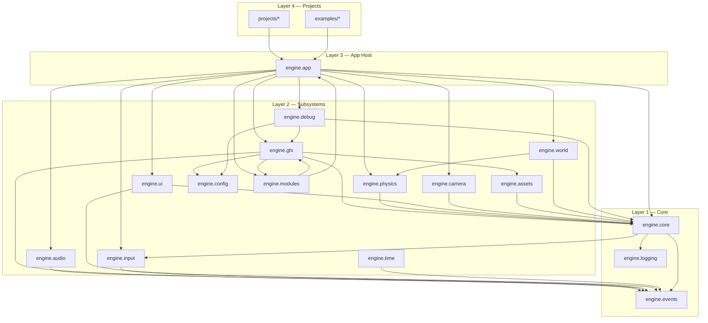
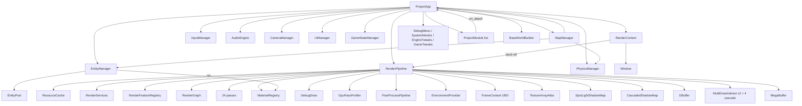
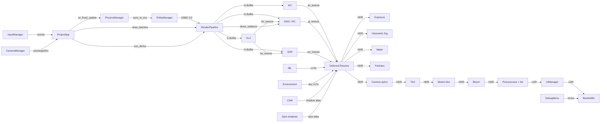
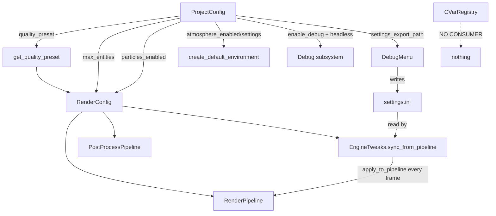
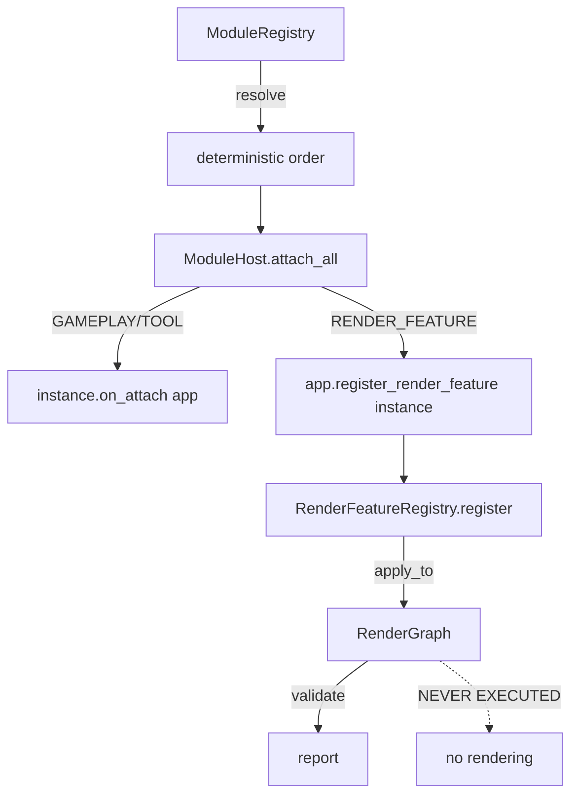

# Dependency Map — Phase 1 Audit

> Import-level dependency graph, ownership graph, and the runtime data flow between systems.
> Derived from actual `import` statements and call sites, not from documentation.

---

## 1. Package-Level Import Graph

Arrows point from importer → imported. Only cross-package edges are shown; intra-package imports are
omitted for readability.

### Confirmed edges worth calling out

| Edge | Why it matters |
|---|---|
| `engine.gfx → engine.modules` | `pipeline.py` imports `create_default_environment`, which lazily imports `engine.modules.atmosphere`. This is a **downward** edge from a subsystem to a module package, which inverts the intended "modules extend the engine" direction. It is lazy (inside a function) so it does not create an import cycle, but it means `engine.gfx` knows about `engine.modules`. |
| `engine.modules → engine.gfx` | `engine/modules/atmosphere/environment.py` imports `SkyAtmospherePass` and `SkyCloudPass` from `engine.gfx.passes`. Combined with the edge above, `engine.gfx` and `engine.modules` are **mutually dependent** at the package level (resolved only by lazy import). |
| `engine.debug → engine.gfx` | `DebugMenu` and `EngineTweaks` reach into `RenderPipeline` and `RenderConfig`. Debug is not a leaf. |
| `engine.core → engine.input` | `engine/core/__init__.py` re-exports `InputManager` from `engine.input`. This is a **backward** edge (core importing a subsystem), contradicting the layer rule. It is a re-export only, but it means `import engine.core` pulls in pygame input. |
| `engine.world → engine.physics` | `MapManager` and mapping scripts create physics bodies. |

### Confirmed violations of the documented layer rule

1. **`engine/core/__init__.py` imports `engine.input`** — core must not depend on a subsystem.
   Mitigation: it is a convenience re-export, and `engine/core/loop.py` imports `engine.input`
   directly too (`from engine.input import InputManager`). So `engine.core.loop` genuinely depends on
   `engine.input`, which depends on pygame. This means the "headless-testable core with no GL
   context" claim holds for GL but **not** for pygame.
2. **`engine.gfx` ↔ `engine.modules` mutual dependency** (lazy, but real).

---

## 2. Ownership Graph (runtime)

### Confirmed ownership facts

- `RenderContext` holds a **back-reference** to `RenderPipeline` (`render_ctx.pipeline = pipeline`),
  and `RenderPipeline` holds `ctx_wrapper`. This is a reference cycle; both are released explicitly
  in `shutdown`, so it is not a leak in practice, but it means neither can be GC'd independently.
- `EntityManager` holds a reference to `MaterialRegistry`, which is owned by `RenderPipeline`. So
  ECS outlives nothing — it depends on the pipeline's registry.
- `MapManager` holds a reference to `ProjectApp` and is constructed by it. `ProjectApp` also holds
  `map_manager`. Another cycle, released by process exit.
- `ProjectModule` instances receive `app` in every hook but do not store it (by contract). A module
  that stores `app` creates a cycle.

---

## 3. Runtime Data Flow (per frame)

### Confirmed data-flow invariants

1. **Hi-Z feeds both SSR and SSGI/RC.** Both fall back to the depth texture with mip count 1 when the
   pyramid is unavailable.
2. **`direct_radiance_texture` is the GI source**, not the composited HDR frame. This prevents a
   feedback loop through the temporal history.
3. **Exposure runs on the resolved HDR scene before any additive effect** (fog, water, particles,
   optics), so the histogram measures scene radiance, not lens flare or bloom.
4. **TAA runs before motion blur and bloom**, so the temporal filter accumulates a sharp image.
5. **UI and ImGui are drawn after post-process**, so they are not tonemapped or anti-aliased.

---

## 4. Configuration Dependency Graph

**Confirmed**: `CVarRegistry` has no edge into the runtime. It is a disconnected node.

**Confirmed**: `EngineTweaks` is the only live, mutable settings surface, and it is applied every
frame, so it overrides `RenderConfig` values set at construction.

---

## 5. Module / Feature Dependency Graph

**Confirmed**: the `RENDER_FEATURE` branch calls `app.register_render_feature(instance)`, which calls
`pipeline.register_feature(feature)`, which calls `feature.create_passes(services)`. But
`RenderFeatureModule` (the documented base class in `module_contracts.py`) defines `on_register`, not
`create_passes`. So a module written against `RenderFeatureModule` will fail at
`feature.create_passes` with `AttributeError`. See [open_questions.md](./open_questions.md) Q2.

---

## 6. Shader Dependency Graph

```mermaid
graph TD
    FD[common/frame_data.glsl] --> CO[camera_optics.frag]
    FD --> MBG[motion_blur_gather.frag]
    FD --> PRV[particle_render.vert]
    FD --> PRF[particle_render.frag]
    FD --> SF[solar_flare.frag]

    DEPTH[common/depth.glsl] --> DR[deferred_resolve.frag]
    DEPTH --> GTAOH[gtao_hiz.frag]
    DEPTH --> HBC[hiz_bounds_copy.comp]
    DEPTH --> RCR[rc_reconstruct.comp]
    DEPTH --> RCS[rc_spatial_filter.comp]
    DEPTH --> RCT[rc_temporal.comp]
    DEPTH --> RCTI[rc_trace_intervals.comp]
    DEPTH --> SSGIT[ssgi_trace.frag]
    DEPTH --> SSRH[ssr_hiz.frag]
    DEPTH --> DUT[depth_util_test.comp]
    DEPTH --> HTT[hiz_trace_test.comp]

    HIZB[common/hiz_bounds.glsl] --> DR
    HIZB --> GTAOH
    HIZB --> HBC
    HIZB --> HBD[hiz_bounds_downsample.comp]
    HIZB --> HBT[hiz_bounds_test.comp]
    HIZB --> RCTI
    HIZB --> SSGIT
    HIZB --> SSRH
    HIZB --> HTT

    HIZT[common/hiz_trace.glsl] --> RCTI
    HIZT --> SSGIT
    HIZT --> SSRH
    HIZT --> HTT

    CSMS[common/csm_sampling.glsl] --> DR
    CSMS --> DRAD[direct_radiance.frag]
    SHAD[common/shadows.glsl] --> DR
    SHAD --> DRAD
    SHAD --> VOL[common/volumetrics.glsl]
    PBR[common/pbr_brdf.glsl] --> DR
    PBR --> DRAD
    PBR --> GB[gbuffer.frag]
    BLUR[common/blur.glsl] --> BB[bilateral_blur.frag]
    BLUR --> BD[bloom_downsample.frag]
    BLUR --> BU[bloom_upsample.frag]
    BLUR --> SSGIB[ssgi_blur.frag]
    BLUR --> SSGITM[ssgi_temporal.frag]
    BLUR --> SSRB[ssr_blur.frag]
    VOL --> PRF
    VOL --> SC[sky_cloud.frag]
    VOL --> VFC[volumetric_fog_composite.frag]
    VOL --> VFI[volumetric_fog_inject.comp]
    VOL --> VFIN[volumetric_fog_integrate.comp]
    TONEMAP[common/tonemap.glsl] --> PP[post_process.frag]
    RCD[common/rc_direction.glsl] --> RCAF[rc_angular_filter.comp]
    RCD --> RCMC[rc_merge_cascades.comp]
    RCD --> RCR
    RCD --> RCTI
    RCC[common/rc_composite.glsl] --> RCAF
    RCC --> RCMC
    ATMO[atmosphere.glsl] --> DR
    HILL[hillaire_common.glsl] --> ATMO
    HILL --> HM[hillaire_multiscattering.frag]
    HILL --> HSV[hillaire_sky_view.frag]
    HILL --> HT[hillaire_transmittance.frag]
```

**Confirmed**: no orphaned shader. The four files not named in Python (`atmosphere.glsl`,
`hillaire_common.glsl`, `frame_data.glsl`, `rc_direction.glsl`) are include libraries.

**Confirmed**: `deferred_resolve.frag` is the single largest dependency sink — it includes
`atmosphere.glsl`, `csm_sampling.glsl`, `depth.glsl`, `hiz_bounds.glsl`, `pbr_brdf.glsl`, and
`shadows.glsl`. Any change to those six files affects the resolve pass.

---

## 7. Test → System Coverage Map

| System | Direct tests | Coverage quality |
|---|---|---|
| ECS | `test_ecs_memory`, `test_material_id`, `test_static_dynamic_separation` | strong |
| Loop/time | `test_loop_determinism`, `test_time_system` | strong |
| State | `test_state_manager`, `test_f1_f2_f3_and_mouse_capture` | strong |
| Events | `test_event_bus` | strong |
| Pipeline | `test_render_pipeline`, `test_phase5_graphics` | strong |
| Render graph | `test_horizon2_render_graph` | strong (validation only — execution untested because it never runs) |
| Render features | `test_horizon2_render_graph` | **gap**: no test asserts a feature's pass actually renders |
| CSM | `test_shadow_csm`, `test_csm_stabilization`, `test_horizon2_csm` | strong |
| Spot shadows | `test_spot_lights` | strong |
| Hi-Z | `test_hiz_pass`, `test_hiz_bounds`, `test_hiz_bounds_api`, `test_hiz_integration`, `test_hiz_tracer` | strong |
| GI | `test_ssgi_reconstruction`, `test_radiance_cascades`, `test_rc_cascades`, `test_rc_intervals` | strong |
| AA | `test_taa`, `test_temporal_pingpong`, `test_aa_stability` | strong |
| Post | `test_tonemap`, `test_exposure`, `test_blur_common` | strong |
| Optics | `test_camera_optics`, `test_solar_flare` | strong (1 stale assertion) |
| Atmosphere | `test_atmosphere`, `test_horizon2_atmosphere_module`, `test_sky_atmosphere_pass`, `test_sun_kinematics` | strong |
| Water | `test_water_pass` | strong |
| Particles | `test_particle_system` | strong |
| Physics | `test_physics_sync`, `test_character_controller`, `test_interactive_gameplay_physics`, `test_raycast_vehicle` | strong |
| Input | `test_input_system`, `test_input_contexts`, `test_example_controls` | strong |
| Audio | `test_audio_engine` | moderate |
| UI | `test_ui_subsystem` | strong |
| Mapping | 6 files | strong |
| Assets | `test_asset_cooker`, `test_async_loader` | strong |
| Debug | `test_debug_system`, `test_debug_backends`, `test_f1_f2_f3_and_mouse_capture`, `test_gpu_profiler` | strong |
| **CVarRegistry** | `test_cvars` | tests the subsystem, but it is unwired |
| **WaypointGraph** | none | **gap** |
| **HudOverlay** | `test_render_pipeline::test_hud_overlay_render` | tests a legacy class |
| **LoadingScreen** | `test_async_loader` | tests the class, not app integration |
| **VolumetricSettings** | `test_volumetrics_common` | tests a duplicate source of truth |

---

## 8. Confirmed Circular / Inverted Dependencies

| # | Cycle / inversion | Severity | Mitigation today |
|---|---|---|---|
| 1 | `engine.gfx` ↔ `engine.modules` | medium | lazy import inside `create_default_environment` |
| 2 | `engine.core` → `engine.input` (layer inversion) | low | re-export + `loop.py` direct import |
| 3 | `RenderContext` ↔ `RenderPipeline` (object cycle) | low | explicit `shutdown` |
| 4 | `ProjectApp` ↔ `MapManager` (object cycle) | low | process exit |
| 5 | `EntityManager` → `MaterialRegistry` (owned by pipeline) | low | pipeline outlives ECS in practice |
| 6 | `RenderFeatureModule.on_register` vs `RenderFeature.create_passes` (contract mismatch) | **high** | none — feature attach fails or silently no-ops |

---

## 9. Files Inspected

All `engine/**/*.py` import statements, `shaders/**` `#include` directives, `tests/**` imports,
`projects/*/main.py`, `examples/*.py`, `pyproject.toml`.

## 10. Files Changed

None.

## 11. Tests Performed

Static analysis only (grep/import scan). No runtime dependency test was added in this phase.

## 12. Results

The dependency graph is acyclic at the module level except for the two documented inversions
(§8 #1, #2), both of which are resolved by lazy imports or re-exports. The **contract mismatch**
(§8 #6) is the only dependency defect that can cause a runtime failure.

## 13. Known Limitations

- Dynamic imports (`importlib`, `__import__`) were not exhaustively traced; only `import` statements
  and `from ... import` were scanned.
- `engine/debug/debug_menu.py` internal imports were not fully mapped (102 KB file).

## 14. Recommended Next Action

Resolve §8 #6 (the `RenderFeatureModule` / `RenderFeature` contract mismatch) together with the
render-feature execution gap, since they are the same subsystem and fixing one without the other
leaves the feature path broken.
