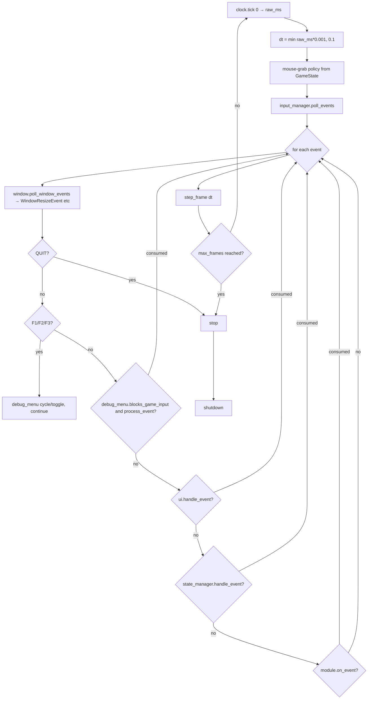

# Frame Lifecycle — Phase 1 Audit

> Read-only trace of one frame, from OS event to presented pixel, with the exact call sites that
> implement each step. Every line reference is to the current working tree.

---

## 1. Entry Points

| Entry point | File | Notes |
|---|---|---|
| `ProjectApp.run()` | [project_app.py:484](../../engine/app/project_app.py:484) | **The real loop.** Used by every project and example. |
| `ProjectApp.step_frame(dt)` | [project_app.py:476](../../engine/app/project_app.py:476) | Headless/CI single step; delegates to `EngineLoop.step_frame`. |
| `EngineLoop.run()` | [loop.py:127](../../engine/core/loop.py:127) | **Dead code.** Zero callers. Divergent duplicate of `ProjectApp.run`. |
| `EngineLoop.step_frame()` | [loop.py:75](../../engine/core/loop.py:75) | The four-phase frame body. |

Confirmed by grep: `engine_loop.run` and `loop.run(` have no call sites in `engine/`, `tests/`,
`examples/`, `projects/`, or `scripts/`.

---

## 2. Per-Frame Sequence (real path)



### 2.1 Event dispatch order (confirmed, [project_app.py:520-580](../../engine/app/project_app.py:520))

1. `render_ctx.window.poll_window_events(ev)` — translates OS events into engine events
   (`WindowResizeEvent`, `WindowFocusEvent`, `WindowModeChangedEvent`).
2. `pygame.QUIT` → stop.
3. `F1` / `F2` / `F3` → `debug_menu` only, then `continue`. **Gameplay never sees these keys.**
4. `debug_menu.process_event(ev)` when `blocks_game_input`.
5. `ui.handle_event(ev)`.
6. `state_manager.handle_event(ev)`.
7. `module.on_event(ev)` — first module returning `True` wins.

**Confirmed invariant**: the reserved debug hotkeys are consumed before any gameplay consumer, which
matches the AGENTS.md rule.

---

## 3. The Four Phases (`EngineLoop.step_frame`)

### Phase 0 — Time

```python
real_dt, game_dt = self.time_system.tick(frame_time)
self.accumulator += game_dt
self.elapsed_time = self.time_system.game_time
self.game_dt = game_dt
```

`TimeSystem.tick` ([time_system.py:51](../../engine/time/time_system.py:51)) clamps `raw_dt` to
`max_delta_time` (0.20 s) and applies `time_scale`. `game_dt` is the scaled delta; `real_dt` is the
unscaled one.

### Phase 1 — Fixed step (0..N times)

```python
while self.accumulator >= self.fixed_dt:
    self.ecs.cache_previous_physics_state()
    if self.on_fixed_update: self.on_fixed_update(self.fixed_dt)
    self.time_system.step_fixed_tick()
    self.fixed_tick_count = self.time_system.fixed_tick_count
    sub_ticks += 1
    self.accumulator -= self.fixed_dt
```

`ProjectApp.on_fixed_step` ([project_app.py:285](../../engine/app/project_app.py:285)):

```text
if current_state and not current_state.allow_fixed_update: return (after recording stage)
current_state.on_fixed_update(app, dt)
map_manager.on_fixed_update(dt)          # kinematic platforms, levers, triggers, streaming
for m in modules if m.enabled: m.on_fixed_update(app, dt)
physics.step_simulation(dt)              # Rapier, constant dt
physics.sync_to_ecs(ecs)                 # contiguous SoA write-back
```

**Confirmed**: `cache_previous_physics_state()` runs *before* the fixed update, so the previous
transform is the pre-step state used by interpolation.

**Confirmed**: physics is stepped exactly once per fixed tick, never in phase 2.

### Phase 2 — Variable step (once per frame)

```python
alpha = self.accumulator / self.fixed_dt if self.fixed_dt > 0 else 0.0
self.ecs.interpolate_render_transforms(alpha)
if self.on_update: self.on_update(game_dt, alpha)
flush_events()
```

`ProjectApp.on_variable_step` ([project_app.py:322](../../engine/app/project_app.py:322)):

```text
current_state.on_update(app, dt)
if not current_state.allow_variable_update: ui.update(dt); monitor.update(dt); return
for m in modules if m.enabled: m.on_update(app, dt)
camera_manager.update(dt)
map_manager.set_observer_position(cam.position)
audio.update(dt, cam.position, cam.forward)
ui.update(dt)
monitor.update(dt)
```

**Confirmed**: `flush_events()` runs *after* `on_update`, so events queued during update are
dispatched in the same frame.

### Phase 3 — Render (once per frame)

`ProjectApp.on_render_step` ([project_app.py:355](../../engine/app/project_app.py:355)):

```text
if current_state and not current_state.allow_render: return
cam = camera_manager.active_camera  (fallback: pos (0,5,10), target origin, fov 60)
_active_draw_batches[:] = _static_draw_batches
for m in modules if m.enabled and hasattr(m,"get_draw_batches"): extend
if _active_draw_batches: extend ecs.explicit_mesh_draw_batches
elif ecs.active_count > 0: extend ecs.mesh_draw_batches
engine_tweaks.apply_to_pipeline(pipeline)
sun_dir = pipeline.atmosphere.sun_direction
sun_lux = pipeline.config.sun_intensity
monitor.begin_gpu_frame()
pipeline.render_frame(ecs, cam_pos, cam_target, elapsed_time, sun_dir, sun_lux,
                      fovy_deg, draw_batches, debug_draw, dt=game_dt)
monitor.end_gpu_frame(); monitor.record_stage("Render Pipeline CPU", ...)
monitor.update_runtime_stats(...)
```

**Confirmed**: `_active_draw_batches[:] = ...` is a slice assignment that reuses list capacity — the
zero-allocation rule is honoured here.

**Confirmed**: `engine_tweaks.apply_to_pipeline` runs every frame, so F2 changes take effect on the
next frame without a restart.

### Phase 4 — UI (once per frame)

`ProjectApp.on_ui_step` ([project_app.py:437](../../engine/app/project_app.py:437)):

```text
post_process.final_fbo.use()
ui.render()
for m in modules if m.enabled: m.on_ui(app)
if not headless:
    ctx.copy_framebuffer(ctx.screen, post_process.final_fbo)
    debug_menu.render()          # Dear ImGui overlays
    window.swap_buffers()
```

**Confirmed**: UI is drawn into the LDR final FBO, then the whole FBO is copied to the backbuffer,
then ImGui draws on top of the backbuffer, then swap. This means ImGui is **not** affected by
tonemapping or AA — it is a true overlay.

---

## 4. Inside `RenderPipeline.render_frame`

Detailed order is in [engine_architecture.md](./engine_architecture.md) §5. The lifecycle-relevant
facts:

1. **Early-out**: `if ecs.active_count <= 0: return` — an empty scene renders nothing at all, not
   even a cleared frame. The previous frame's contents remain on screen.
2. **Profiler**: `gpu_profiler.begin_frame()` at entry; `end_frame()` is called inside
   `render_frame` (not by the caller). Results are harvested from older frames (ring of 3), so no
   `glFinish` and no stall.
3. **Resize guard**: `if w != hiz_pass.width or h != hiz_pass.height: hiz_pass.resize(w, h)` — a
   defensive re-sync in case a resize event was missed.
4. **Static/dynamic split**: SSBO upload only re-uploads the dynamic slice each frame; the static
   slice is uploaded once and on `mark_static_split`.
5. **TAA jitter**: applied to the projection matrix when `aa_mode == "TAA"` or `taa_enabled`.
6. **Environment**: `env.update(dt)` then `compute_lighting()`; the pipeline never reads atmosphere
   config directly.
7. **Culling**: per-cascade shadow culling, then camera frustum + optional Hi-Z occlusion culling.
8. **Passes**: see §5 of the architecture doc.
9. **History**: `_prev_vp_mat` / `_prev_view_mat` stored at the end for next frame's motion vectors;
   dynamic transforms snapshotted as "previous" for object motion vectors.

---

## 5. Frame-Time Measurement Paths (confirmed)

| Measurement | Where | Mechanism | Stall risk |
|---|---|---|---|
| CPU stage timings | `SystemMonitor.record_stage` | `time.perf_counter_ns()` deltas | none |
| CPU frame time | `SystemMonitor.record_frame_time` | from `dt` | none |
| GPU pass timings | `GpuPassProfiler` | `GL_TIMESTAMP` query ring, `frame_lag=3` | none (reads older frames) |
| FPS | `TimeSystem.fps` / `EngineLoop.fps` | 1-second window | none |

**Confirmed**: `GpuPassProfiler` wraps G-buffer, Hi-Z, AO, GI, SSR, and deferred-resolve
submissions. It disables itself (`_disable(reason)`) if the context lacks timer queries, recording
the counter as unavailable rather than fabricating a value — this satisfies the "no fabricated GPU
counters" rule.

**Confirmed**: no `glFinish` appears in the runtime path. Grep for `glFinish`/`finish()` in
`engine/gfx/` returns no runtime use.

---

## 6. Resize Path (confirmed)

```text
pygame.VIDEORESIZE
  → Window.poll_window_events → WindowResizeEvent
  → EventBus.publish
      → RenderContext._on_window_resize (priority 100) → ctx.viewport + pipeline.resize
      → RenderPipeline._on_window_resize (priority 90) → pipeline.resize
      → UIManager._on_window_resize → set_screen_size
```

`RenderPipeline.resize` ([pipeline.py:927](../../engine/gfx/pipeline.py:927)) reallocates G-Buffer,
AO + blur pair, Hi-Z, SSGI, SSR, TAA/SMAA, volumetrics, bloom, HDR, and final LDR targets.

**Confirmed**: `render_frame` also defensively re-syncs `hiz_pass` dimensions each frame, so a
missed resize event cannot leave the Hi-Z pyramid stale.

---

## 7. Shutdown Path (confirmed)

See [engine_architecture.md](./engine_architecture.md) §3. Lifecycle-relevant ordering:

1. Game states popped (so `on_exit` hooks run while the app is still alive).
2. Modules detached in reverse attach order.
3. World torn down (frees mesh allocations and static colliders).
4. Screenshot (if configured) — taken **before** the pipeline is destroyed, so the framebuffer is
   still valid.
5. UI destroyed, audio stopped, monitor destroyed.
6. Pipeline destroyed, then context destroyed.

**Confirmed defect**: `pipeline.destroy()` omits `water_pass`, `spot_shadow_map`,
`spot_depth_prog`/`spot_depth_vao`, `cascade_shadow_mdis`, and `render_features.destroy_all()`.

---

## 8. Headless Path (confirmed)

`ProjectConfig.headless=True`:

- `RenderContext(..., hidden=True)` — no visible window.
- Debug subsystem is **not** constructed (`enable_debug and not headless`).
- `on_ui_step` skips `copy_framebuffer`, `debug_menu.render()`, and `swap_buffers()`.
- `ProjectApp.run` still runs the full loop; `step_frame` is used by tests directly.

**Confirmed**: headless still allocates the full GPU pipeline, so headless tests exercise real
shader compilation and pass execution.

---

## 9. Determinism Notes (confirmed)

- Fixed step uses a constant `fixed_dt = 1/fixed_hz`; `TimeSystem` clamps `raw_dt` to
  `max_delta_time` (0.20 s), so a long stall produces at most 12 fixed ticks per frame at 60 Hz.
- `accumulator` is decremented by exactly `fixed_dt` per tick, so `alpha` is deterministic for a
  given sequence of `frame_time` inputs.
- `tests/test_loop_determinism.py` covers this.

**Confirmed risk**: `ProjectApp.run` clamps `dt` to `0.1` *before* passing it to `step_frame`, while
`TimeSystem` clamps to `0.20`. The tighter clamp in the app means the time system's clamp is never
reached in the real loop — a subtle double-clamp that is harmless but redundant.

---

## 10. Open Items

- Whether `render_frame`'s `active_count <= 0` early-out is intended (blank screen on empty scene)
  or a bug — see [open_questions.md](./open_questions.md) Q4.
- Whether the `dt` double-clamp (§9) is intentional.
