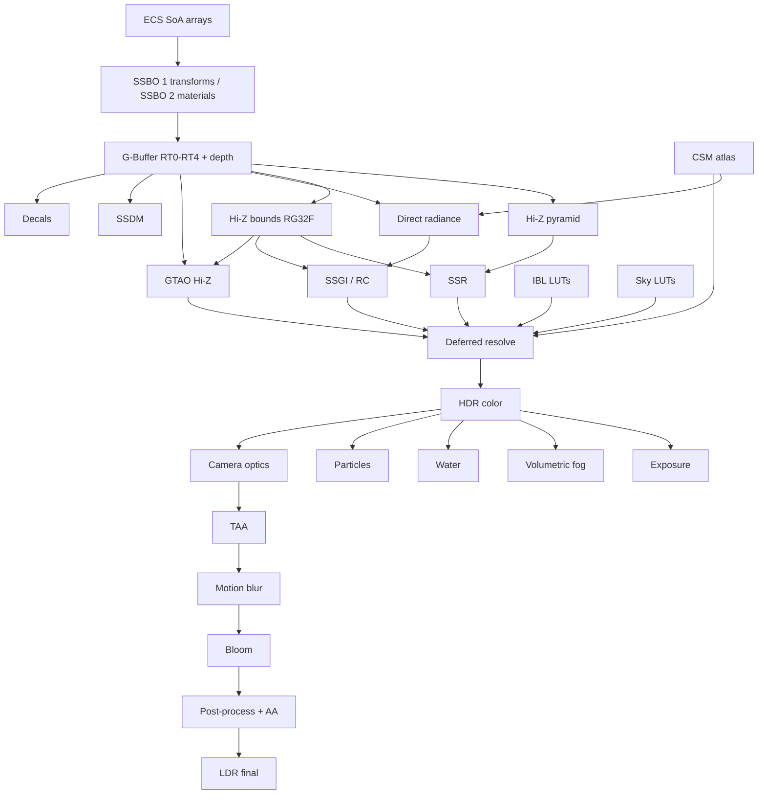

# Feature Dependency Matrix — Phase 2

> **Documentation-only.** Shows what each graphics feature *requires* to produce its intended
> result, what it *conflicts* with, and what breaks if a dependency is missing.
>
> Derived from the actual gate conditions in `RenderPipeline.render_frame`, each pass's `execute`,
> and the shader bindings. See [feature_inventory.md](./feature_inventory.md) for per-feature detail.

---

## 1. Legend

| Symbol | Meaning |
|---|---|
| **→** | requires (hard dependency; feature is wrong or absent without it) |
| **⇢** | soft dependency (degrades gracefully) |
| **⊗** | mutually exclusive (only one may be active) |
| **⚠** | known defect in the dependency chain |

---

## 2. Core Resource Chain

Everything downstream depends on this chain. A break here invalidates every feature above it.

**⚠ Chain break 1**: `render_frame` returns immediately when `ecs.active_count <= 0`. Every feature
in this chain is skipped, including sky and clear. See [open_questions.md](../audit/open_questions.md) Q4.

**⚠ Chain break 2**: `RenderPipeline.destroy` does not release `water_pass`, `spot_shadow_map`,
`spot_depth_prog`/`vao`, `cascade_shadow_mdis`, or render features. This does not break rendering,
but it leaks GPU memory across app lifetimes.

---

## 3. Per-Feature Dependency Table

### 3.1 Geometry

| Feature | Requires | Soft | Conflicts | Breaks if missing |
|---|---|---|---|---|
| MDI base | MegaBuffer, ECS transforms, SSBO 1/2 | — | — | no geometry |
| MDI fallback | `u_BaseInstance` uniform | — | — | double-draw if mixed with fast path |
| Tessellation | `GL_ARB_tessellation_shader`, displacement array, `tess_enabled` | POM | — | falls back to flat G-Buffer |
| Wireframe | — | — | AA (visual) | n/a |

### 3.2 Material / PBR

| Feature | Requires | Soft | Conflicts | Breaks if missing |
|---|---|---|---|---|
| PBR base | G-Buffer RT0/RT1 | IBL, GI | — | flat shading |
| Energy compensation | PBR base | — | — | rough metal darkens |
| Specular AA | G-Buffer normals | — | — | specular shimmer |
| POM | height array, view dir | tessellation | — | flat surface |
| SSDM | G-Buffer depth/normals, displacement array | — | — | no mid-distance relief |
| Material atlas | cooked `.pm` textures | — | — | no textured materials |

### 3.3 Direct Lighting

| Feature | Requires | Soft | Conflicts | Breaks if missing |
|---|---|---|---|---|
| Directional sun | CSM | IBL | — | unshadowed sun |
| Point lights | SSBO 3 | — | — | no local light |
| Spot lights | SSBO 3 | — | — | no cone light |
| Spot shadows | `SpotLightShadowMap`, `cast_shadow=True` | — | — | unshadowed spot |

### 3.4 IBL

| Feature | Requires | Soft | Conflicts | Breaks if missing |
|---|---|---|---|---|
| Split-sum IBL | env map, BRDF LUT | sky LUTs | — | black ambient |
| `gi_mode="IBL"` | — | — | — | **⚠ behaves as `OFF`** |

### 3.5 Shadows

| Feature | Requires | Soft | Conflicts | Breaks if missing |
|---|---|---|---|---|
| CSM | per-cascade frustum culling | — | — | no shadows |
| Hard filter | CSM | — | ⊗ PCF/PCSS per cascade | — |
| PCF | CSM | — | ⊗ HARD/PCSS per cascade | — |
| PCSS | CSM | — | ⊗ HARD/PCF per cascade | — |
| Stabilization | CSM | — | — | shadow crawl |

**⚠ Note**: `shadow_filter_mode` is a single global string, but `pcf_cascade_limit` and
`pcss_cascade_limit` make the filter *per-cascade*: cascades below the limit use the cheaper filter.
So HARD/PCF/PCSS are not strictly global-exclusive — they are layered by cascade index.

### 3.6 AO

| Feature | Requires | Soft | Conflicts | Breaks if missing |
|---|---|---|---|---|
| SSAO | G-Buffer depth/normals | — | ⊗ GTAO | no AO |
| GTAO legacy | G-Buffer depth/normals | — | ⊗ SSAO | no AO |
| GTAO Hi-Z | `hiz_bounds_texture` | — | ⊗ SSAO | **⚠ falls back to LEGACY silently** |
| AO debug views | GTAO Hi-Z | — | — | n/a |

### 3.7 GI

| Feature | Requires | Soft | Conflicts | Breaks if missing |
|---|---|---|---|---|
| SSGI legacy | direct radiance, G-Buffer | Hi-Z | ⊗ RC | no indirect |
| SSGI Hi-Z | `hiz_bounds_texture` | — | ⊗ RC | **⚠ falls back to LEGACY silently** |
| SSGI debug | SSGI Hi-Z | — | — | n/a |
| RC legacy | direct radiance, G-Buffer | — | ⊗ SSGI | no indirect |
| RC cascades | `hiz_bounds_texture`, `build_cascades` | — | ⊗ SSGI | no indirect |
| RC debug | RC cascades | — | — | n/a |

**⚠ Note**: `gi_mode` is strictly exclusive — `render_frame` branches on exactly one of
`"RADIANCE_CASCADES"` / `"SSGI"` / else. There is no "both".

### 3.8 Reflections

| Feature | Requires | Soft | Conflicts | Breaks if missing |
|---|---|---|---|---|
| SSR legacy | G-Buffer, scene color, Hi-Z | — | — | no reflections |
| SSR Hi-Z | `hiz_bounds_texture` | — | — | **⚠ falls back to LEGACY silently** |
| SSR march mode | Hi-Z pyramid | — | — | linear march |
| SSR debug | SSR Hi-Z | — | — | n/a |

### 3.9 Sky / Atmosphere

| Feature | Requires | Soft | Conflicts | Breaks if missing |
|---|---|---|---|---|
| Hillaire sky | `EnvironmentProvider` | — | — | flat sky |
| Space mode | Hillaire sky | — | ⊗ ATMOSPHERE mode | — |
| Clouds | Hillaire sky, depth | — | — | no clouds |
| Presets | Hillaire sky | — | — | — |
| Flat fallback | — | — | ⊗ Hillaire | — |

**⚠ Note**: `create_default_environment` wraps the atmosphere import in `except Exception` and
silently returns `FlatEnvironment`. A broken atmosphere module produces a flat sky with **no log
message**. See [open_questions.md](../audit/open_questions.md) Q17.

### 3.10 Volumetrics

| Feature | Requires | Soft | Conflicts | Breaks if missing |
|---|---|---|---|---|
| Froxel fog | G-Buffer depth, CSM, point lights | — | — | no fog |
| Fog resolution | Froxel fog | — | — | — |
| Fog debug | Froxel fog | — | — | — |
| VolumetricSettings | — | — | — | **⚠ unused; no effect** |

### 3.11 Transparency / Water

| Feature | Requires | Soft | Conflicts | Breaks if missing |
|---|---|---|---|---|
| Particle blend | particle SSBO, compute | — | — | no particles |
| Water refraction | opaque copy FBO, depth | — | — | no water |
| Water waves | `WaterProperties` | — | — | static water |

### 3.12 Terrain

| Feature | Requires | Soft | Conflicts | Breaks if missing |
|---|---|---|---|---|
| Grid terrain | `PMMesh` | — | — | no ground |
| Heightmap terrain | — | — | — | **absent** |

### 3.13 Particles

| Feature | Requires | Soft | Conflicts | Breaks if missing |
|---|---|---|---|---|
| Compute sim | compute capability | — | — | static particles |
| DUST_MOTES | compute sim | — | — | — |
| EMBERS | compute sim | — | — | — |
| FIREFLIES | compute sim | — | — | — |

### 3.14 Anti-Aliasing

| Feature | Requires | Soft | Conflicts | Breaks if missing |
|---|---|---|---|---|
| TAA | jittered projection, motion vectors, G-Buffer | — | ⊗ FXAA/SMAA | no temporal AA |
| FXAA | LDR | — | ⊗ SMAA/TAA | — |
| SMAA | LDR | — | ⊗ FXAA/TAA | — |
| No AA | LDR | — | — | — |

**⚠ Note**: TAA is gated by `taa_active` (from `aa_mode=="TAA"` or `taa_enabled`), while FXAA/SMAA
are gated by `aa_mode` inside post-process. Setting `aa_mode="FXAA"` **and** `taa_enabled=True`
would run both — the exclusivity is by convention, not enforced. This is a new finding from Phase 2
and is recorded here rather than in the Phase 1 question list.

### 3.15 Resolution Scaling

| Feature | Requires | Soft | Conflicts | Breaks if missing |
|---|---|---|---|---|
| AO scale | AO pass | — | — | full-res AO |
| SSGI scale | SSGI pass | — | — | full-res SSGI |
| RC scale | RC pass | — | — | full-res RC |
| SSR scale | SSR pass | — | — | full-res SSR |
| Flare scale | flare pass | — | — | full-res flare |

### 3.16 Tone Mapping

| Feature | Requires | Soft | Conflicts | Breaks if missing |
|---|---|---|---|---|
| ACES | post-process | — | — | — |
| AgX | post-process | — | — | — |
| Neutral | post-process | — | — | — |
| Reinhard | post-process | — | — | — |

All four are mutually exclusive by `u_TonemapMode` (single int).

### 3.17 Exposure

| Feature | Requires | Soft | Conflicts | Breaks if missing |
|---|---|---|---|---|
| Manual | post-process | — | ⊗ auto | — |
| Auto | resolved HDR | — | ⊗ manual | — |

### 3.18 Bloom

| Feature | Requires | Soft | Conflicts | Breaks if missing |
|---|---|---|---|---|
| Bloom | HDR | — | — | no glow |

### 3.19 Color Grading

| Feature | Requires | Soft | Conflicts | Breaks if missing |
|---|---|---|---|---|
| White balance | post-process | — | — | — |
| Contrast | post-process | — | — | — |
| Saturation | post-process | — | — | — |
| CDL | post-process | — | — | — |
| Chromatic aberration | post-process | — | — | — |
| Vignette | post-process | — | — | — |
| Film grain | post-process | — | — | — |

All are independent multiplicative/additive stages in `post_process.frag`; none conflict.

### 3.20 Depth of Field

| Feature | Requires | Soft | Conflicts | Breaks if missing |
|---|---|---|---|---|
| DoF circular | depth | — | — | — |
| DoF hexagonal | depth | — | — | — |
| DoF anamorphic | depth | — | — | — |

Mutually exclusive by `u_BokehShape` (single int).

### 3.21 Motion Blur

| Feature | Requires | Soft | Conflicts | Breaks if missing |
|---|---|---|---|---|
| Motion blur | velocity buffer (RT2), depth | TAA | — | no blur |

**⚠ Note**: motion blur runs **after** TAA by design. Running it before TAA double-blurs. This is
enforced by pass order, not by a guard.

### 3.22 Debug Visualization

| Feature | Requires | Soft | Conflicts | Breaks if missing |
|---|---|---|---|---|
| 24 debug modes | the resource being debugged | — | replaces normal resolve | — |
| Debug wireframes | — | — | — | — |
| F1/F2/F3 | imgui-bundle | — | — | no overlay |

### 3.23 Temporal

| Feature | Requires | Soft | Conflicts | Breaks if missing |
|---|---|---|---|---|
| TAA history | prev VP, motion vectors | — | — | ghosting |
| SSGI history | prev view | — | — | ghosting |
| RC history | prev view | — | — | ghosting |
| RC cascades temporal | `rc_temporal_enabled` | — | — | **⚠ default False** |
| Motion vectors | prev VP, prev transforms | — | — | no blur |

### 3.24 Culling

| Feature | Requires | Soft | Conflicts | Breaks if missing |
|---|---|---|---|---|
| Frustum culling | ECS AABBs, VP matrix, `max_entities` scratch | — | — | no culling |
| Hi-Z culling | Hi-Z pyramid, `cull_indirect.comp` | — | — | no occlusion culling |
| Mesh LOD | — | — | — | **absent** |

---

## 4. Cross-Feature Interaction Matrix

Rows and columns are feature groups. A cell describes what happens when both are active.

| | Shadows | AO | GI | SSR | Fog | Water | Particles | TAA | Bloom |
|---|---|---|---|---|---|---|---|---|---|
| **Shadows** | — | AO darkens shadowed areas | GI samples shadowed direct radiance | SSR reflects shadowed pixels | Fog scatters shadowed light | Water reflects shadows | Particles lit by shadows | TAA stabilizes shadow edges | Bloom on bright lit areas |
| **AO** | — | — | GI and AO both darken creases (double-darkening risk) | — | — | — | — | TAA stabilizes AO noise | — |
| **GI** | — | — | — | — | Fog uses GI ambient | Water refracts GI | — | TAA stabilizes GI noise | GI can push bloom |
| **SSR** | — | — | — | — | — | — | — | TAA stabilizes SSR noise | SSR highlights bloom |
| **Fog** | — | — | — | — | — | Fog over water | Fog over particles | TAA stabilizes fog | Fog brightens bloom |
| **Water** | — | — | — | — | — | — | — | TAA stabilizes water | Water highlights bloom |
| **Particles** | — | — | — | — | — | — | — | TAA stabilizes particles | Additive particles bloom |
| **TAA** | — | — | — | — | — | — | — | — | TAA before bloom |
| **Bloom** | — | — | — | — | — | — | — | — | — |

**⚠ Double-darkening risk**: AO and GI both darken contact regions. With both at high intensity,
crevices can go black. This is a tuning interaction, not a bug, but it is the most common
"looks wrong" report.

---

## 5. Dependency Failure Modes

| Missing dependency | Silent fallback? | Visible symptom | Detectable by |
|---|---|---|---|
| `hiz_bounds_texture` | **yes** (falls back to LEGACY) | none — feature silently degrades | comparing GPU ms; debug view 17–22 |
| `hiz_texture` | **yes** (mip=1, linear march) | slower SSR/SSGI | GPU ms |
| atmosphere module | **yes** (`FlatEnvironment`) | flat sky, no log | visual only |
| `GL_ARB_tessellation_shader` | no (program creation fails) | startup exception | log |
| `GL_ARB_multi_draw_indirect` | **yes** (per-command path) | slower | GPU ms |
| compute capability | no (program creation fails) | startup exception | log |
| `max_entities` mismatch | **no** | silent corruption | visual only |
| `direct_radiance_texture` | no (GI reads black) | no indirect light | GI debug view |

**⚠ The three silent fallbacks** (`hiz_bounds`, `hiz`, atmosphere) are the highest-risk items for
manual verification: a feature can appear "working" while actually running its legacy path. The
manual matrix must A/B against the legacy backend to detect this.

---

## 6. Pass Order Dependencies (why order matters)

| Constraint | Reason | Enforced by |
|---|---|---|
| CSM before G-Buffer | shadow casters must be rendered first | pass order |
| G-Buffer before AO/GI/SSR | they read G-Buffer | pass order |
| Hi-Z before SSR/SSGI | they read the pyramid | pass order |
| Direct radiance before GI | GI samples it, not HDR | pass order |
| GI before resolve | resolve composites it | pass order |
| Resolve before exposure | exposure measures scene radiance | pass order |
| Exposure before fog/water/particles | histogram must not include additive effects | pass order |
| TAA before motion blur | blur must not be temporally accumulated | pass order |
| Motion blur before bloom | bloom should not blur | pass order |
| Bloom before post-process | bloom is added to HDR | pass order |
| Post-process before UI | UI must not be tonemapped | pass order |

**⚠ None of these are asserted at runtime.** They are comments and call order. A future refactor
that reorders `render_frame` would silently break them. The `RenderGraph` exists to encode these
constraints but is never executed (see [engine_architecture.md](../audit/engine_architecture.md) §6).

---

## 7. Files Inspected

`engine/gfx/pipeline.py` (pass order + gates), `engine/gfx/passes/*.py` (execute gates),
`engine/gfx/environment.py`, `engine/gfx/render_graph.py`, `engine/gfx/render_feature.py`,
`shaders/deferred_resolve.frag` (uniform gates), `shaders/common/*.glsl`.

## 8. Files Changed

None. Only `docs/graphics/*.md` created.

## 9. Tests Performed

Static analysis only.

## 10. Results

- 3 silent fallbacks identified (`hiz_bounds`, `hiz`, atmosphere).
- 1 silent corruption risk (`max_entities` mismatch).
- 11 pass-order constraints documented, none asserted at runtime.
- 1 double-darkening interaction (AO + GI).
- 1 unenforced exclusivity (TAA + FXAA/SMAA).

## 11. Known Limitations

- The interaction matrix describes *expected* interactions from shader reads; it was not validated
  by rendering.
- Per-cascade shadow filter layering (§3.5) was inferred from `pcf_cascade_limit` /
  `pcss_cascade_limit`; the exact per-cascade behaviour was not traced into the shader.

## 12. Recommended Next Action

Add the three silent fallbacks to the manual matrix as explicit A/B tests (already present as
GI2/R2/A3). If any of them shows no difference from LEGACY, the fallback is masking a broken
backend — record it as PASS WITH ISSUES, not PASS.
