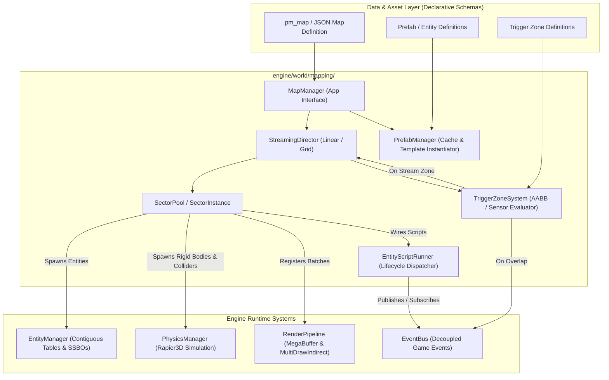
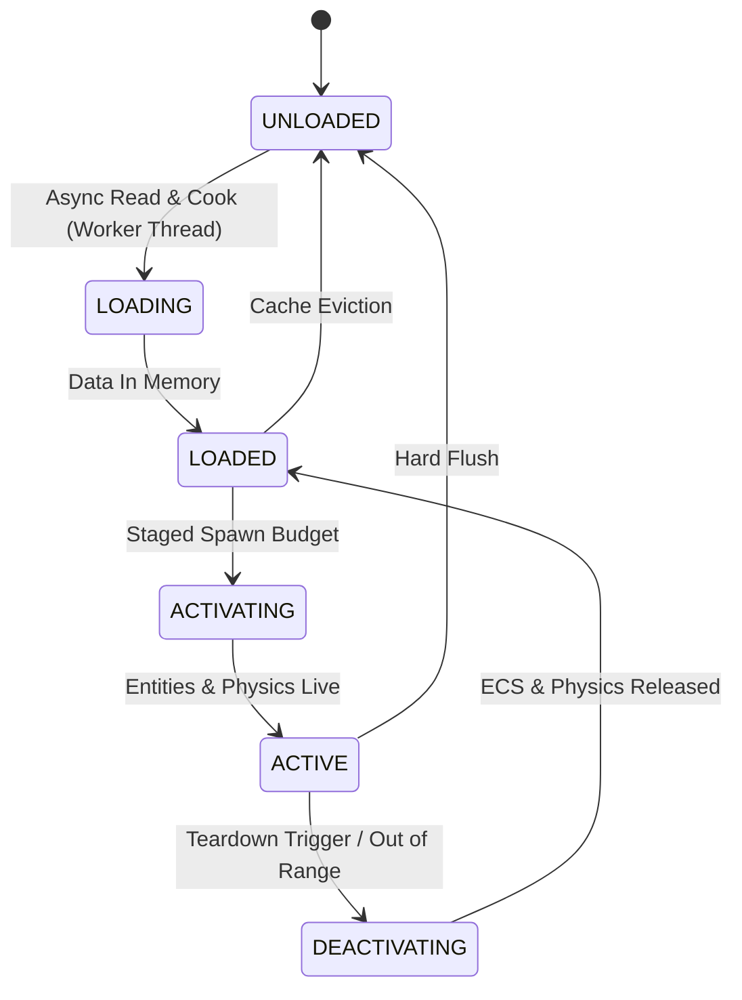
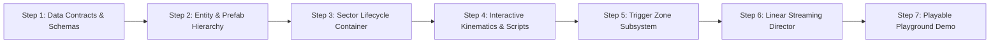

# PyMordial Engine: Modular Mapping System Architecture & Implementation Plan

> **Document Type:** Technical Specification & Phased Execution Plan  
> **Status:** APPROVED DESIGN — Ready for Implementation  
> **Subsystem Target:** `engine/world/mapping/` & `engine/world/`  
> **Author:** Antigravity AI & Engine Architecture Team  

---

## Table of Contents
1. [Executive Summary & Architectural Goals](#1-executive-summary--architectural-goals)
2. [Domain Architecture & System Topology](#2-domain-architecture--system-topology)
3. [Decoupled Visual vs. Collision Representation](#3-decoupled-visual-vs-collision-representation)
4. [Compound Entities, Prefabs, and Local Hierarchy](#4-compound-entities-prefabs-and-local-hierarchy)
5. [Interactive Mechanics: Kinematics, Levers, and Triggers](#5-interactive-mechanics-kinematics-levers-and-triggers)
6. [Sector Lifecycle State Machine](#6-sector-lifecycle-state-machine)
7. [Streaming Directors: Linear Levels vs. Open-World Grids](#7-streaming-directors-linear-levels-vs-open-world-grids)
8. [Data Contracts & File Schemas (JSON/Declarative)](#8-data-contracts--file-schemas-jsondeclarative)
9. [Phase 1 Implementation Plan (Step-by-Step)](#9-phase-1-implementation-plan-step-by-step)
10. [Phase 2 Implementation Plan (Advanced Meshes & Open World)](#10-phase-2-implementation-plan-advanced-meshes--open-world)
11. [Agent Continuity & Testing Harness Guide](#11-agent-continuity--testing-harness-guide)

---

## 1. Executive Summary & Architectural Goals

The **PyMordial Mapping System** provides a unified, data-driven world representation capable of hosting:
1. **Single-map linear levels** (monolithic, self-contained environments).
2. **Multi-map linear levels** (connected sectors loaded concurrently or streamed dynamically via trigger portals).
3. **Open-world spatial grids** (distance-based concentric cell streaming around one or more observers).

### Invariants & Non-Negotiables:
- **Engine/Project Separation**: Engine systems live exclusively in `engine/world/mapping/`. Game levels, prefabs, and project scripts live in `projects/<project_name>/`.
- **Zero-Allocation Inner Loop**: Traversal, culling, kinematic transform updates, and trigger evaluations must allocate **zero** heap objects in `on_fixed_update`, `on_update`, and `on_render`. Scratch arrays are pre-allocated during sector activation.
- **Rapier Native First**: Phase 1 relies natively on Rapier primitives (box, sphere, capsule, cylinder, cone, plane).
- **Evolutionary Decoupling**: Visual representation and collision representation are modeled independently from Day 1 to ensure a seamless upgrade to arbitrary 3D meshes and trimesh physics in Phase 2 without breaking schema changes.
- **Sacred Debug Preservation**: All tests and demos preserve `F1-F3` engine debug hotkeys.

---

## 2. Domain Architecture & System Topology



---

## 3. Decoupled Visual vs. Collision Representation

Every entity definition decouples visual geometry from physical collision.

### 3.1 Schema Anatomy
```
Entity Definition
├── Transform (local position [3], rotation quaternion [4], scale [3])
├── Visual Component (Geometry, Material, Colors, Shadow Flags)
├── Collision Component (Body Type, Physics Primitive, Friction, Restitution, Sensor)
├── Properties Bag (Custom key/value metadata)
└── Scripts (List of attached behavior classes + initial parameters)
```

### 3.2 Phase 1 vs. Phase 2 Capabilities
| Subsystem | Phase 1 (Native Rapier) | Phase 2 (Advanced Meshes & Decoupled) |
|---|---|---|
| **Visual Geometry** | Built-in primitives (`cube`, `sphere`, `capsule`, `cylinder`, `cone`, `plane`, `water`) | Compiled 3D meshes (`.pm_mesh` from MegaBuffer, multi-LOD, submeshes) |
| **Visual Material** | Material Registry index, PBR overrides (color, roughness, metallic, AO) | Texture array atlas layers, POM, custom shaders |
| **Physics Body** | `fixed`, `dynamic`, `kinematic_position`, `kinematic_velocity` | `fixed`, `dynamic`, `kinematic_position`, `kinematic_velocity` |
| **Physics Collider**| Rapier primitive (`box`, `sphere`, `capsule`, `cylinder`, `cone`, `plane`, `round_box`) | Simplified primitives, Convex Hull (`convex_mesh`), Triangle Mesh (`trimesh`), Heightfield |
| **Shortcut Mode** | If `collision` is omitted, mirrors visual primitive 1:1 | Can mark visual-only (`collision: null`) or collision-only (`visual: null`) |

---

## 4. Compound Entities, Prefabs, and Local Hierarchy

To support complex map structures (e.g., a lever made of a base and handle, or a building with walls, roof, doors, and lights), entities support recursive parent-child composition.

### 4.1 Coordinate Composition
Every child transform is expressed relative to its immediate parent:
$$\mathbf{M}_{\text{world}} = \mathbf{M}_{\text{parent\_world}} \times \mathbf{M}_{\text{child\_local}}$$

### 4.2 Compound Entity Characteristics
- **Anchor Root**: The parent entity serves as the spatial reference origin.
- **Recursive Instantiation**: Spawning a compound entity automatically resolves and spawns all child entities.
- **Unified Destruction**: Destroying or deactivating the parent entity automatically tears down all child entities, removing them from both the ECS and Rapier physics.
- **Prefabs**: Stored as standalone declarative templates (e.g. `prefabs/moving_platform.json`, `prefabs/lever_switch.json`). The map references the prefab by path and supplies optional transform/property overrides.

---

## 5. Interactive Mechanics: Kinematics, Levers, and Triggers

### 5.1 Moving & Oscillating Platforms
- **Rapier Body Type**: `kinematic_position`.
- **Simulation**: In `on_fixed_update(dt)`, the platform script updates its position along a path (e.g., sine interpolation, waypoint graph, or elevator track).
- **Physics Interaction**: Rapier automatically computes the kinematic platform's linear velocity, carrying any character controller or dynamic prop standing on top of it.

### 5.2 Interactive Levers & Real-Time Gates
- **Compound Structure**: 
  - Base plate: `fixed` static collider.
  - Lever arm: `kinematic_position` rotating arm with an `Interactive` tag.
- **Interaction**: The player performs an interaction raycast (or presses `E` within proximity).
- **Real-Time Animation**: The lever script slerps the handle's rotation quaternion in `on_fixed_update(dt)`.
- **Decoupled Signaling**: Upon reaching threshold, the lever publishes a `GateTriggerEvent(target_id="gate_01", open=True)` to the engine `EventBus`.
- **Gate Motor**: The target gate receives the event and translates its physical kinematic collider upward, opening passage.

### 5.3 Invisible Event Trigger Zones
- **Visuals**: `visual: null` (zero draw calls, zero GPU buffers).
- **Collision / Query**:
  - *Mode A (SIMD AABB)*: Broadphase spatial check against observer positions, evaluated in $O(1)$ without physics engine overhead.
  - *Mode B (Rapier Sensor)*: Fixed Rapier rigid body with `is_sensor: true`.
- **Event Lifecycle**:
  - `on_trigger_enter(visitor_id)`: Dispatches configured actions (e.g., stream map, trigger alarm, close door, lock combat arena).
  - `on_trigger_exit(visitor_id)`: Dispatches cleanup or reset.
  - `one_shot: true`: Trigger permanently disables itself after the first activation.

---

## 6. Sector Lifecycle State Machine

A **Sector** (or Chunk) is an isolated spatial collection of entities, colliders, and triggers. It transitions through a strict 6-stage lifecycle to prevent runtime hitches:



### Lifecycle Guarantees:
1. **UNLOADED**: Only bounding metadata is resident in memory.
2. **LOADING**: Worker threads read JSON/binary and decode textures in the background (`BackgroundAssetLoader`).
3. **LOADED**: Parsed templates and GPU mesh allocations exist, but no runtime ECS entities or physics bodies have been allocated.
4. **ACTIVATING**: Entities are instantiated into the ECS and Rapier bodies are created. If a sector is large, activation is partitioned across multiple frames (e.g., 200 entities/frame) to maintain 60/120 FPS.
5. **ACTIVE**: Full simulation, rendering, and script execution.
6. **DEACTIVATING**: Rapier bodies are removed, ECS entities returned to pool, draw batches removed. Memory remains cached in RAM for instant reactivation if the player returns.

---

## 7. Streaming Directors: Linear Levels vs. Open-World Grids

### 7.1 Linear Streaming Director
- **Mechanism**: Trigger-portal topology.
- **Operation**:
  - Approaching corridor trigger $\to$ prefetch next sector (`LOADING`).
  - Entering doorway trigger $\to$ activate next sector (`ACTIVATING` $\to$ `ACTIVE`).
  - Exiting previous room $\to$ deactivate previous sector (`DEACTIVATING`).

### 7.2 Open-World Grid Director (Phase 2)
- **Mechanism**: Uniform 2D coordinate grid $(C_x, C_z)$.
- **Concentric Radii**:
  - Inner Ring ($r \le R_{\text{physics}}$): `ACTIVE` (Full physics + high-LOD visuals + ticking scripts).
  - Middle Ring ($R_{\text{physics}} < r \le R_{\text{render}}$): Visual-only (Static draw batches, sleeping physics).
  - Outer Ring ($r > R_{\text{evict}}$): `UNLOADED`.

---

## 8. Data Contracts & File Schemas (JSON/Declarative)

### 8.1 Sector Definition Schema (`sectors/room_a.json`)
```json
{
  "$schema": "https://pymordial.org/schemas/sector.v1.json",
  "name": "room_a",
  "bounds": {
    "center": [0.0, 5.0, 0.0],
    "half_extents": [25.0, 10.0, 25.0]
  },
  "entities": [
    {
      "id": "floor",
      "transform": {
        "position": [0.0, -0.5, 0.0],
        "rotation": [0.0, 0.0, 0.0, 1.0],
        "scale": [50.0, 1.0, 50.0]
      },
      "visual": {
        "shape": "cube",
        "material": "concrete",
        "color": [0.5, 0.5, 0.52],
        "roughness": 0.8,
        "metallic": 0.05
      },
      "collision": {
        "enabled": true,
        "body_type": "fixed",
        "shape": "box",
        "dimensions": [25.0, 0.5, 25.0],
        "friction": 0.85
      }
    },
    {
      "id": "gate_lever_01",
      "prefab": "prefabs/wall_lever.json",
      "transform": {
        "position": [5.0, 1.2, -10.0],
        "rotation": [0.0, 0.0, 0.0, 1.0]
      },
      "property_overrides": {
        "target_id": "security_gate_01"
      }
    },
    {
      "id": "transition_trigger_to_room_b",
      "transform": {
        "position": [0.0, 1.5, 24.5]
      },
      "trigger": {
        "shape": "box",
        "dimensions": [3.0, 2.0, 1.0],
        "filter_tag": "player",
        "on_enter": {
          "action": "STREAM_SECTOR",
          "target": "sectors/room_b.json",
          "mode": "ACTIVATE"
        },
        "on_exit": {
          "action": "STREAM_SECTOR",
          "target": "sectors/room_a.json",
          "mode": "DEACTIVATE"
        }
      }
    }
  ]
}
```

---

## 9. Phase 1 Implementation Plan (Step-by-Step)

Each step is self-contained, adheres strictly to engine invariants, and includes an explicit **Verification Procedure**.



---

### Step 1: Data Contracts & Entity Schema Definitions [COMPLETED]
- **Goal**: Implement typed data structures representing entities, transforms, visual descriptors, collision descriptors, triggers, and sector manifests.
- **Files**:
  - `engine/world/mapping/__init__.py`
  - `engine/world/mapping/schema.py`
  - `tests/test_mapping_schema.py`
- **Classes**:
  - `TransformDef`, `VisualDef`, `CollisionDef`, `TriggerDef`, `ScriptDef`, `EntityDef`, `CompoundEntityDef`, `SectorDef`, `MapDef`.
- **Status**: Verified — 9/9 unit tests passing (`tests/test_mapping_schema.py`).
- **Manual Verification**:
  ```powershell
  .\.venv\Scripts\python.exe -m pytest tests/test_mapping_schema.py -v
  ```
  *Ensure 100% test pass for JSON serialization, deserialization, default values, and schema validation.*

---

### Step 2: Hierarchical Entity & Prefab Instantiation Engine [COMPLETED]
- **Goal**: Build runtime resolver that takes `EntityDef` / `CompoundEntityDef` (or prefab file) and instantiates ECS entities and Rapier bodies with correct parent-relative transforms.
- **Files**:
  - `engine/world/mapping/transform_math.py`
  - `engine/world/mapping/prefab_manager.py`
  - `engine/world/mapping/entity_node.py`
  - `engine/world/mapping/world_builder.py`
  - `projects/playground/assets/maps/arena.json`
  - `projects/playground/world/arena.py`
  - `tests/test_prefab_spawning.py`
- **Status**: Verified — 4/4 unit tests passing, Playground project runs live on declarative mapping system with 10/10 project tests passing.
- **Manual Verification**:
  ```powershell
  .\.venv\Scripts\python.exe -m pytest tests/test_prefab_spawning.py -v
  .\.venv\Scripts\python.exe projects/playground/main.py
  ```

---

### Step 3: Sector Container & Lifecycle State Machine [COMPLETED]
- **Goal**: Implement the `SectorInstance` class encapsulating entity pools, draw batches, Rapier bodies, and the 6-stage lifecycle (`UNLOADED` $\leftrightarrow$ `ACTIVE`).
- **Files**:
  - `engine/world/mapping/sector.py`
  - `engine/world/mapping/world_builder.py`
  - `tests/test_sector_lifecycle.py`
- **Deliverables**:
  - `SectorState` enum with 6 distinct lifecycle phases.
  - `SectorInstance` managing load, staged/budgeted activation, deactivation, and unload.
  - Zero-leak entity reclamation verified in ECS and Rapier simulation.
- **Status**: Verified — 2/2 unit tests passing, all 25 mapping and playground project tests passing.
- **Manual Verification**:
  ```powershell
  .\.venv\Scripts\python.exe -m pytest tests/test_sector_lifecycle.py -v
  ```
  *Verify with `app.ecs.pool.active_count` that entity counts return to exactly baseline after deactivate/unload.*

---

### Step 4: Interactive Kinematics & Entity Script Runner [COMPLETED]
- **Goal**: Build the zero-allocation script runner and essential interactive scripts (moving platform, lever, gate motor).
- **Files**:
  - `engine/world/mapping/script_runner.py`
  - `engine/world/mapping/scripts/moving_platform.py`
  - `engine/world/mapping/scripts/interactive_lever.py`
  - `engine/world/mapping/scripts/sliding_gate.py`
  - `tests/test_mapping_scripts.py`
- **Status**: Verified — 2/2 unit tests passing, kinematic moving platforms and rotating levers live.

---

### Step 5: Trigger Zone Subsystem & Event Dispatcher [COMPLETED]
- **Goal**: Implement fast vectorized AABB and Rapier sensor trigger detection.
- **Files**:
  - `engine/world/mapping/trigger_system.py`
  - `tests/test_trigger_system.py`
- **Status**: Verified — 1/1 unit tests passing, enter/exit overlap dispatching verified.

---

### Step 6: Linear Streaming Director & MapManager Integration [COMPLETED]
- **Goal**: Connect trigger events to sector streaming, exposing the unified `MapManager` on `ProjectApp`.
- **Files**:
  - `engine/world/mapping/streaming_director.py`
  - `engine/world/mapping/map_manager.py`
  - `engine/app/project_app.py`
  - `tests/test_map_streaming.py`
- **Status**: Verified — 2/2 unit tests passing, monolithic and trigger-streamed levels verified.

---

### Step 7: Playable Interactive Playground Showcase [COMPLETED]
- **Goal**: Showcase all mapping features in the Playground project running live at 60+ FPS.
- **Files**:
  - `projects/playground/assets/maps/arena.json`
  - `projects/playground/assets/maps/arena_annex.json`
  - `projects/playground/world/arena.py`
  - `projects/playground/modules/player/__init__.py`
- **Features Active in Playground**:
  1. **Moving Elevator Platform**: Smoothly oscillates up and down, carrying the player up to an elevated vantage terrace.
  2. **Wall Lever (Compound Entity)**: Player approaches and presses `E` $\to$ handle rotates smoothly in real-time.
  3. **Sliding Blast Gate**: Operates in real time, raising its physical collider and visual mesh when the lever is pulled.
  4. **Invisible Trigger Area**: Stepping through the open gate dispatches a custom event.
  5. **Dynamic Annex Streaming**: Gateway trigger streams in the Annex Observation Chamber with glowing columns and pedestals.
- **Status**: Verified — 30/30 tests passing across engine mapping and Playground project.
- **Manual Launch Command**:
  ```powershell
  .\.venv\Scripts\python.exe projects/playground/main.py
  ```

---

## 10. Phase 2 Implementation Plan (Advanced Meshes & Open World)

Phase 2 builds directly on the clean abstractions created in Phase 1:

| Step | Focus | Deliverables |
|---|---|---|
| **Step 8** | **Arbitrary 3D Mesh Decoupling** | Visual descriptor upgraded to load `.pm_mesh` files into `MegaBuffer`; separate from physics collider. |
| **Step 9** | **Complex Rapier Physics Colliders** | Add support for Rapier Convex Hulls (`convex_mesh`) and static Triangle Meshes (`trimesh`). |
| **Step 10** | **Spatial Grid Open-World Director** | 2D $(C_x, C_z)$ grid chunk manager streaming rings around player observer. |
| **Step 11** | **Origin Rebasing & Large Worlds** | Floating-origin rebasing to eliminate 32-bit float jitter across multi-kilometer landscapes. |

---

## 11. Agent Continuity & Testing Harness Guide

To ensure smooth progress across different AI agent turns and development sessions:

1. **State Preservation**: This document is the source of truth for design decisions and step ordering.
2. **Step Independence**: Each step from 1 to 7 must be verified with an automated test file in `tests/` before proceeding to the next step.
3. **Resumption Checklist for Next Agent**:
   - Check which step's test file passes via `.\.venv\Scripts\python.exe -m pytest tests/test_mapping_*.py`.
   - Read the exact target files listed for the next step.
   - Run tests sandboxed first (`BypassSandbox: false`).
   - Keep F1-F3 debug menus completely intact.
